# Gateway (GW) Network Packet Communication — Architecture Document

> **Author:** GW Engineering Team
> **Date:** 2026-11-14
> **Status:** Architecture Blueprint
> **Language:** C++11
> **Source Docs:** [problemStatement.md](problemStatement.md) · [GW_Requirement_Specification.docx](GW_Requirement_Specification.docx)

---

## Table of Contents

1. [System Overview](#1-system-overview)
2. [Design Principles — OOP, SOLID, Clean Code & Rule of 0/3/5](#2-design-principles--oop-solid-clean-code--rule-of-035)
3. [High-Level Architecture](#3-high-level-architecture)
4. [Layer-by-Layer Architecture](#4-layer-by-layer-architecture)
5. [Detailed Component Architecture](#5-detailed-component-architecture)
6. [Component Responsibilities & Key Interfaces](#6-component-responsibilities--key-interfaces)
7. [Data Flow & Sequence Diagrams](#7-data-flow--sequence-diagrams)
8. [Technology Stack](#8-technology-stack)
9. [Security Architecture & Principles](#9-security-architecture--principles)
10. [Error Handling Strategy](#10-error-handling-strategy)
11. [Monitoring & Logging Strategy](#11-monitoring--logging-strategy)
12. [Scalability Strategy](#12-scalability-strategy)
13. [Testing & Evaluation Strategy](#13-testing--evaluation-strategy)
14. [Project Directory Structure](#14-project-directory-structure)
15. [Phase-Wise Development Plan](#15-phase-wise-development-plan)

---

## 1. System Overview

### 1.1 Purpose

The **Gateway (GW) Network Packet Communication System** is a production-grade, multi-threaded TCP/IP application built in **C++11** that translates packets between a proprietary *Network Node* wire format and a normalized payload format. The Gateway receives encrypted request packets from network node clients, validates their structure and integrity, performs a cryptographic transformation pipeline (decrypt → nibble-swap → re-encrypt), and returns appropriately formatted positive or negative response packets.

The system is designed using **object-oriented programming (OOP)** principles, follows the **SOLID** design principles, applies **Clean Code** practices, enforces the **C++ Rule of Zero / Five** for resource management, and employs well-known **GoF design patterns** to achieve modularity, testability, and extensibility.

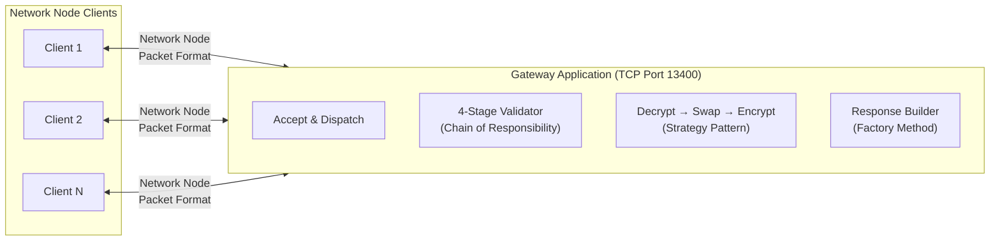

### 1.2 Core Capabilities

- **Protocol Translation** — Converts between proprietary encrypted Network Node format and plain payload format
- **Multi-client Concurrency** — Thread-per-connection model ensures zero-drop request processing under concurrent load
- **Fail-Fast Validation** — 4-stage validation pipeline using the **Chain of Responsibility** pattern; short-circuits at the first failure
- **Pluggable Crypto Pipeline** — XOR-based encryption/decryption implemented via the **Strategy** pattern for interchangeable crypto algorithms
- **Nibble Transformation** — High/low nibble swap applied to every decrypted payload byte
- **Integrity Verification** — CRC-8 algorithm ensures end-to-end data integrity
- **Cross-Platform Support** — Runs on Windows (Winsock2) and Linux (POSIX sockets/pthreads) via an abstraction layer
- **RAII Resource Management** — Sockets, threads, and buffers managed via C++ RAII ensuring zero resource leaks

### 1.3 Dual-Application System Model

The system comprises two distinct executable applications sharing a common protocol and cryptography core:

1. **Gateway Server (`gw_server`):**
   - High-throughput TCP server listening on port `13400`
   - Manages concurrent client sessions via dedicated worker threads
   - Enforces the 4-stage fail-fast validation pipeline (Chain of Responsibility)
   - Decrypts client payload (`XOR 0xAA`), executes nibble-swapping, encrypts response (`XOR 0x55`), computes response CRC-8, and routes back responses
   - **Zero-drop policy:** every request receives an explicit Positive or Negative response

2. **Diagnostic Client / Network Node Simulator (`gw_client`):**
   - TCP client capable of connecting to `gw_server` on `127.0.0.1:13400` or arbitrary IP/port
   - Assembles valid or intentionally malformed request packets (supporting automated conformance testing)
   - Encrypts payload with `0xAA` and computes CRC-8 over encrypted payload bytes
   - Receives and parses responses: decrypts positive responses with `0x55`, extracts raw failure codes from negative responses
   - Provides both an interactive CLI mode and an automated batch/test execution mode

3. **Common Protocol & Processing Engine (`libgw_common`):**
   - Reusable static library compiled once and linked into both `gw_server` and `gw_client`
   - Encapsulates types, platform abstraction, CRC-8, XOR crypto, nibble swapping, header parsing, and TCP stream framing
   - All components exposed as well-defined **classes with clean interfaces (abstract base classes / pure virtual methods)**

---

## 2. Design Principles — OOP, SOLID, Clean Code & Rule of 0/3/5

### 2.1 Object-Oriented Programming (OOP) Principles

The system is designed as a class hierarchy leveraging all four pillars of OOP:

| OOP Pillar | Application in GW System |
|------------|--------------------------|
| **Encapsulation** | Each class hides its internal state behind a public interface. `Packet` owns its raw buffer; `TcpSocket` hides the OS socket handle; `Crc8Calculator` encapsulates the polynomial and initial value. No public data members — all access via methods. |
| **Abstraction** | Abstract base classes (`IValidator`, `ICryptoStrategy`, `ITransform`, `IResponseBuilder`) define pure-virtual contracts that decouple consumers from concrete implementations. |
| **Inheritance** | `PositiveResponseBuilder` and `NegativeResponseBuilder` inherit from the abstract `IResponseBuilder`. Validation stages inherit from `IValidationHandler`. Socket wrappers inherit from `ISocket`. |
| **Polymorphism** | The processing pipeline invokes validation, crypto, and transformation through base-class pointers/references, allowing runtime substitution without modifying the pipeline code. |

### 2.2 SOLID Principles

Every class and module in the system adheres to the five SOLID principles:

| Principle | Definition | Application in GW System |
|-----------|------------|--------------------------|
| **S — Single Responsibility** | A class should have only one reason to change | `Crc8Calculator` only computes CRC-8. `XorCryptoStrategy` only performs XOR encryption/decryption. `PacketParser` only extracts header fields. `TcpServer` only manages socket lifecycle. `ConnectionHandler` only orchestrates the per-connection pipeline. |
| **O — Open/Closed** | Classes should be open for extension but closed for modification | New validation stages can be added by implementing `IValidationHandler` and inserting into the chain — without modifying existing validators. New crypto algorithms can be added by implementing `ICryptoStrategy` — without modifying the pipeline. |
| **L — Liskov Substitution** | Derived classes must be substitutable for their base classes | `PositiveResponseBuilder` and `NegativeResponseBuilder` are fully substitutable for `IResponseBuilder`. Any `ICryptoStrategy` implementation (XOR, AES, etc.) works in the transformation pipeline without behavior changes. |
| **I — Interface Segregation** | Clients should not be forced to depend on interfaces they don't use | `IValidator` is separate from `IResponseBuilder`. `ICryptoStrategy` is separate from `ITransform`. The client binary depends only on `IRequestBuilder` and `IResponseParser` — never on server-only interfaces. |
| **D — Dependency Inversion** | High-level modules should depend on abstractions, not concrete implementations | `ConnectionHandler` depends on `IValidator&`, `ICryptoStrategy&`, `ITransform&`, and `IResponseBuilder&` — all abstract interfaces. Concrete classes are injected via constructors (Dependency Injection). |

### 2.3 Design Patterns

The following Gang of Four (GoF) and other established design patterns are applied:

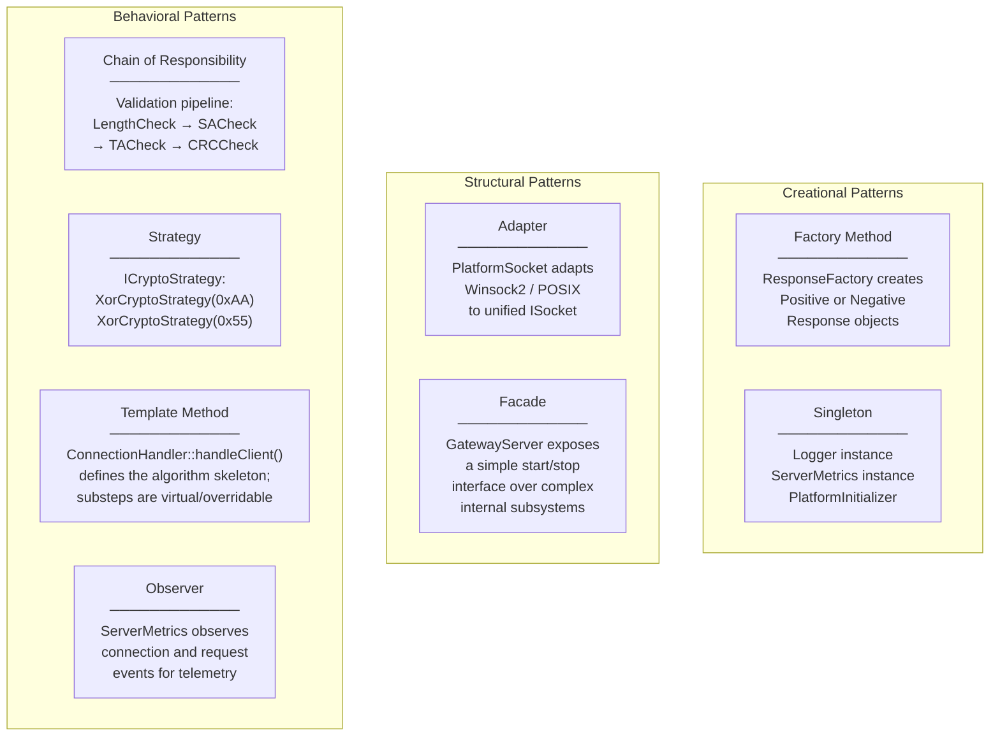

#### Detailed Pattern Mapping

| Pattern | Category | Where Applied | Benefit |
|---------|----------|---------------|---------|
| **Chain of Responsibility** | Behavioral | `ValidationChain`: `LengthValidator` → `SourceAddressValidator` → `TargetAddressValidator` → `CrcValidator`. Each handler either rejects or passes to the next. | Fail-fast pipeline; easy to reorder or add stages without modifying existing ones (Open/Closed). |
| **Strategy** | Behavioral | `ICryptoStrategy` interface with `XorCryptoStrategy` concrete class. Request decryption uses key `0xAA`; response encryption uses key `0x55`. The same interface can support future algorithms. | Swappable crypto algorithms; Single Responsibility per strategy; testable in isolation. |
| **Factory Method** | Creational | `ResponseFactory::create()` returns either a `PositiveResponse` or `NegativeResponse` based on validation result. | Decouples response creation from usage; Open/Closed for new response types. |
| **Template Method** | Behavioral | `ConnectionHandler::handleClient()` defines the skeleton: `readFrame()` → `validate()` → `transform()` → `buildResponse()` → `send()`. Subclasses/injected dependencies customize each step. | Fixed algorithm structure with flexible steps; enforces processing order. |
| **Singleton** | Creational | `Logger::instance()` — single global logger. `ServerMetrics::instance()` — single metrics collector. | Controlled global access; thread-safe initialization via `std::call_once`. |
| **Adapter** | Structural | `PlatformSocket` adapts OS-specific Winsock2 / POSIX socket APIs to a unified `ISocket` interface. `PlatformThread` adapts Win32 / pthreads to a unified thread API. | Cross-platform compatibility without polluting business logic with `#ifdef`. |
| **Facade** | Structural | `GatewayServer` class provides a simple `start()` / `stop()` interface that internally orchestrates `TcpServer`, `ConnectionHandler`, `ValidationChain`, `CryptoStrategy`, and `Metrics`. | Simplified top-level API; hides subsystem complexity. |
| **Observer** | Behavioral | `ServerMetrics` observes connection/request events. `ConnectionHandler` notifies the metrics observer on request processed, validation failure, connect/disconnect. | Decoupled telemetry from processing logic; easily add new observers (file logger, dashboard). |
| **RAII (Resource Acquisition Is Initialization)** | Idiom | `SocketGuard` wraps a socket handle and auto-closes on destruction. `std::unique_ptr` manages dynamically allocated buffers. `std::lock_guard` protects shared state. | Guarantees zero resource leaks even on exceptions or early returns. |

### 2.4 Additional Design Tenets

- **Deterministic Processing** — Every input produces a predictable, reproducible output (no randomness or external state dependency)
- **Strict Protocol Compliance** — Wire formats, address constants, XOR keys, and CRC parameters match the specification exactly
- **RAII Everywhere** — Sockets, threads, mutexes, and dynamic memory managed via RAII wrappers — no manual `close()` or `delete`
- **Const Correctness** — All read-only parameters and methods are `const`-qualified
- **`nullptr` over `NULL`** — C++11 `nullptr` used exclusively for null pointer semantics
- **`enum class` over `enum`** — Scoped enumerations prevent implicit integer conversion
- **`std::array` / `std::vector` over raw C arrays** — Bounds-safe, size-aware containers
- **`auto` for clarity** — Used where the type is obvious from context, reducing verbosity
- **Rule of Zero by Default** — Prefer classes that need no custom destructor, copy, or move operations; let `std::vector`, `std::unique_ptr`, and `std::string` manage resources automatically
- **Explicit Resource Ownership** — Every resource has exactly one owner; ownership transfers via `std::unique_ptr` or move semantics; non-owning access via raw pointers or references
- **No Raw `new`/`delete`** — All heap allocation via `std::unique_ptr` with `new` (C++11; `std::make_unique` is C++14); no manual `delete` in application code
- **Clean Code Naming** — Classes are nouns (`Packet`, `CrcValidator`), methods are verbs (`compute()`, `validate()`, `apply()`), booleans read as predicates (`isValid`, `hasNext`)

### 2.5 Clean Code Principles

The codebase follows **Robert C. Martin's Clean Code** principles to maximize readability, maintainability, and correctness:

| Principle | Definition | Application in GW System |
|-----------|------------|--------------------------|
| **Meaningful Names** | Names reveal intent; no abbreviations or cryptic identifiers | `XorCryptoStrategy` not `XorCS`; `validatePacket()` not `vp()`; `sourceAddr_` not `sa_`; `FailureCode::IntegrityFailure` not `FC_04` |
| **Small Functions** | Each function does exactly one thing (SRP at function level) | `ConnectionHandler::handleClient()` delegates to `readFrame()`, `parseFrame()`, `validatePacket()`, `transformPayload()`, `buildResponse()`, `sendResponse()` — each ≤ 20 lines |
| **No Side Effects** | Pure functions where possible — given the same input, always produce the same output | `Crc8Calculator::compute()` is a pure function; `NibbleSwapTransform::apply()` modifies only its explicit buffer parameter; `XorCryptoStrategy::process()` modifies only its explicit buffer parameter |
| **DRY (Don't Repeat Yourself)** | Every piece of knowledge has a single authoritative representation | Common chaining logic lives once in `BaseValidator`; CRC computation lives once in `Crc8Calculator`; framing logic lives once in `StreamFramer`; address constants defined once in `gw_config.hpp` |
| **YAGNI (You Ain't Gonna Need It)** | No premature abstractions; only interfaces with 2+ implementations or a clear extension point | `ICryptoStrategy` has `XorCryptoStrategy` (and is explicitly designed for future AES); `ITransform` exists because nibble swap is one of many possible transforms; no `ILogger` interface — `Logger` is a concrete singleton because there's only one logging strategy |
| **Boy Scout Rule** | Leave every file cleaner than you found it | Enforced via clang-tidy checks and `-Wall -Wextra -Werror` zero-warning policy |
| **Fail Fast** | Detect and report errors at the earliest possible point | Validation chain short-circuits at first failure; `StreamFramer` throws on socket error; `PacketParser` throws `std::invalid_argument` on undersized buffer |
| **Composition over Inheritance** | Prefer composing objects via injection over deep inheritance hierarchies | `ConnectionHandler` composes `IValidator&`, `ICryptoStrategy&`, `ITransform&`, `ResponseFactory&` via constructor injection — max inheritance depth is 2 (interface → concrete) |
| **Command-Query Separation (CQS)** | A method should either change state (command) OR return a value (query), never both | Commands: `process(data, len)` modifies buffer in-place, returns `void`. Queries: `compute(data, len)` returns CRC byte without modifying input. `getKey()` returns key without side effects |
| **Minimal Public Interface** | Only expose what clients need; all internals are `private` | No public data members; `BaseValidator::doValidate()` is `protected` (extension point); `ConnectionHandler` pipeline steps are all `private`; `Logger`/`ServerMetrics` constructors are `private` (Singleton) |

### 2.6 C++ Rule of 0 / 3 / 5

C++11 provides three guidelines for managing **special member functions** (destructor, copy constructor, copy assignment operator, move constructor, move assignment operator). These rules ensure correct resource management and prevent resource leaks, double-free bugs, and slicing.

#### Rule of Zero

> **If a class manages no resources directly, do not declare any of the Big Five.** Let the compiler generate them automatically.

Classes whose members are all self-managing types (`std::vector`, `std::string`, `const` scalars, references, non-owning raw pointers) should rely entirely on compiler-generated defaults. This eliminates bugs from hand-written copy/move/destroy logic.

#### Rule of Five

> **If a class manages a resource (socket handle, raw pointer, file descriptor), it must explicitly declare or delete ALL FIVE special member functions:** destructor, copy constructor, copy assignment, move constructor, move assignment.

In this system, resource-owning classes either:
- **Delete copy, default/implement move** (move-only types like `SocketGuard`, `ConnectionHandler`, `TcpClient`)
- **Delete copy AND move** (non-transferable types like `GatewayServer`, `TcpServer`, singletons)

#### Rule of Three (Legacy)

> If you need a custom destructor, copy constructor, or copy assignment operator, you probably need all three.

**Not used in this project.** The Rule of Three is a C++03 guideline superseded by the Rule of Five in C++11 (which adds move semantics). All resource-owning classes in this system follow the Rule of Five.

#### Rule of Two (Heuristic)

> If you need a custom destructor, you almost certainly need custom copy/move operations too.

This is an informal heuristic that leads directly to the Rule of Five. It serves as a code-review red flag: any class with a user-defined destructor but no explicit copy/move declarations is a potential bug.

#### Classification Table — All Classes

| Class | Rule | ~Dtor | Copy Ctor | Copy `=` | Move Ctor | Move `=` | Rationale |
|-------|------|:-----:|:---------:|:--------:|:---------:|:--------:|-----------|
| `Packet` | **Zero** | — | — | — | — | — | Value object; `std::vector` member self-manages |
| `Crc8Calculator` | **Zero** | — | — | — | — | — | Only `const uint8_t` members; trivially copyable |
| `XorCryptoStrategy` | **Zero** | — | — | — | — | — | Only `const uint8_t key_`; trivially copyable |
| `NibbleSwapTransform` | **Zero** | — | — | — | — | — | Stateless; no data members |
| `PacketParser` | **Zero** | — | — | — | — | — | Static methods only; no instances created |
| `StreamFramer` | **Zero** | — | — | — | — | — | Static methods only; no instances created |
| `BaseValidator` | **Zero** | — | — | — | — | — | Non-owning `IValidationHandler*` pointer; no resource |
| `LengthValidator` | **Zero** | — | — | — | — | — | Inherits `BaseValidator`; no added resources |
| `SourceAddressValidator` | **Zero** | — | — | — | — | — | Inherits `BaseValidator`; no added resources |
| `TargetAddressValidator` | **Zero** | — | — | — | — | — | Inherits `BaseValidator`; no added resources |
| `CrcValidator` | **Zero** | — | — | — | — | — | Stores `const Crc8Calculator&` (non-owning ref) |
| `ResponseFactory` | **Zero** | — | — | — | — | — | Stores `const` references only (non-owning) |
| `RequestBuilder` | **Zero** | — | — | — | — | — | Stores `const` references only (non-owning) |
| `ResponseParser` | **Zero** | — | — | — | — | — | Stores `const` references only (non-owning) |
| `ISocket` | **Zero** | `= default` | — | — | — | — | Interface; virtual dtor needed for polymorphic delete |
| `ICryptoStrategy` | **Zero** | `= default` | — | — | — | — | Interface; virtual dtor needed for polymorphic delete |
| `ITransform` | **Zero** | `= default` | — | — | — | — | Interface; virtual dtor needed for polymorphic delete |
| `IValidationHandler` | **Zero** | `= default` | — | — | — | — | Interface; virtual dtor needed for polymorphic delete |
| `SocketGuard` | **Five** | ✅ closes | `= delete` | `= delete` | ✅ transfer | ✅ transfer | Owns raw socket handle (`gw_socket_t`); move-only |
| `ConnectionHandler` | **Five** | `= default` | `= delete` | `= delete` | `= default` | `= default` | Owns `std::unique_ptr<ISocket>`; move-only |
| `TcpClient` | **Five** | ✅ disconnect | `= delete` | `= delete` | ✅ transfer | ✅ transfer | Owns socket connection; move-only |
| `TcpServer` | **Five** | ✅ stop+join | `= delete` | `= delete` | `= delete` | `= delete` | Owns listener socket + thread vector; non-movable |
| `GatewayServer` | **Five** | ✅ stop | `= delete` | `= delete` | `= delete` | `= delete` | Owns validators, threads, `std::atomic`; non-movable |
| `Logger` | **Five** | `= default` | `= delete` | `= delete` | `= delete` | `= delete` | Singleton; non-copyable, non-movable |
| `ServerMetrics` | **Five** | `= default` | `= delete` | `= delete` | `= delete` | `= delete` | Singleton; non-copyable, non-movable |

> [!NOTE]
> **"—"** means the compiler generates the default implementation (Rule of Zero). **"= default"** means explicitly defaulted. **"= delete"** means explicitly deleted. **"✅"** means a user-defined implementation is required.

> [!IMPORTANT]
> **Interface classes** (`ISocket`, `ICryptoStrategy`, `ITransform`, `IValidationHandler`) declare `virtual ~Destructor() = default` solely to enable safe polymorphic deletion through base-class pointers. They still follow the Rule of Zero spirit — no resource management, no custom copy/move.

---

## 3. High-Level Architecture

The system is structured as a **three-tier stack** with shared infrastructure:

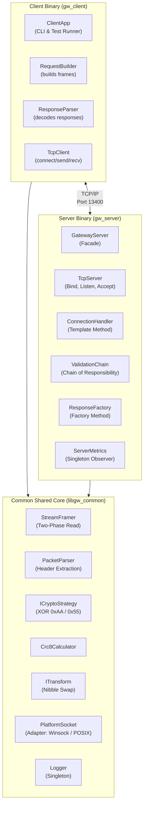

### 3.1 Protocol Summary

| Aspect | Request (Client → Server) | Positive Response (Server → Client) | Negative Response (Server → Client) |
|--------|---------------------------|-------------------------------------|--------------------------------------|
| **Source Address** | `0x0E80` or `0xE008` | `0x3108` or `0x1380` | `0x3108` or `0x1380` |
| **Target Address** | `0x3108` or `0x1380` | `0x0E80` or `0xE008` | `0x0E80` or `0xE008` |
| **XOR Key** | `0xAA` | `0x55` | N/A (failure code unencrypted) |
| **Payload** | Encrypted raw data | Encrypted nibble-swapped data | Single failure code byte |
| **CRC** | CRC-8 over encrypted payload | CRC-8 over encrypted payload | CRC-8 over failure code |

---

## 4. Layer-by-Layer Architecture

### 4.1 Network Layer (TCP/IP)

Handles all socket lifecycle management, connection acceptance, and raw byte transport.

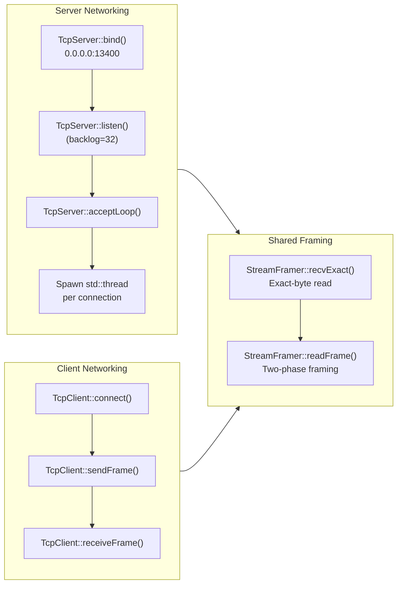

| Sub-Component | Role | C++ Class | Technology |
|---------------|------|-----------|------------|
| **TCP Server Socket** | Binds, listens, and accepts incoming connections on port 13400 | `TcpServer` | BSD Sockets / Winsock2 via `PlatformSocket` adapter |
| **Worker Threads** | Spawns a dedicated `std::thread` per accepted client connection | `ConnectionHandler` | `std::thread` (C++11 standard threading) |
| **TCP Client Socket** | Connects to server, sends request frames, receives response frames | `TcpClient` | BSD Sockets / Winsock2 via `PlatformSocket` adapter |
| **Stream Framer** | Two-phase read: 8-byte header first, then `Length` bytes of body | `StreamFramer` | Shared in `libgw_common` |
| **Platform Abstraction** | Adapter that unifies socket APIs across Windows and Linux | `PlatformSocket` (Adapter pattern) | Winsock2 / POSIX |

---

### 4.2 Protocol Layer (Parsing & Validation)

Extracts structured fields from raw byte buffers and enforces protocol compliance using the **Chain of Responsibility** pattern.

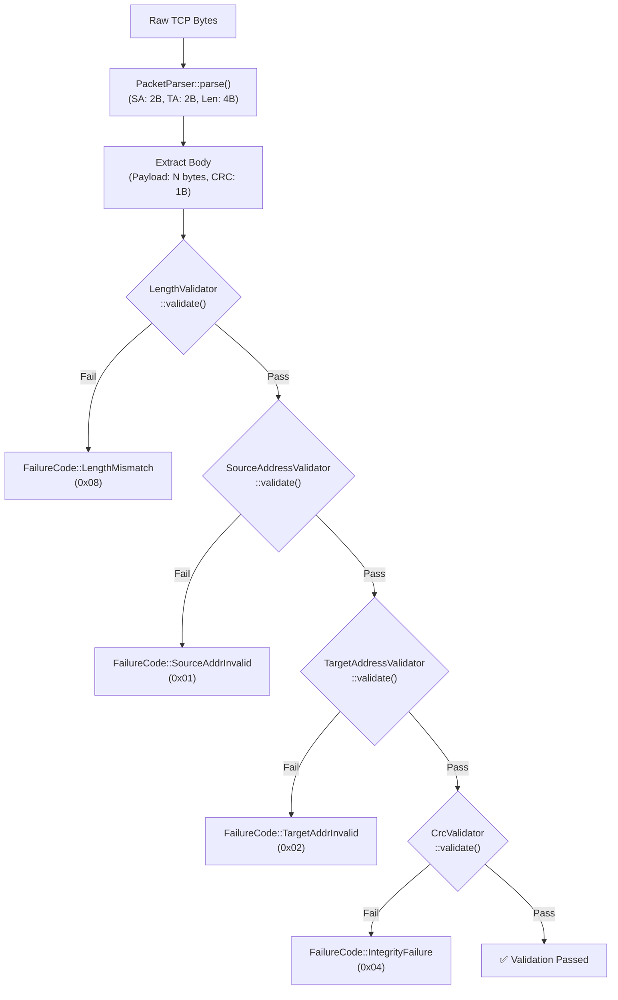

---

### 4.3 Processing Layer (Crypto & Transformation)

Performs the core data transformation pipeline using the **Strategy** pattern for crypto operations.

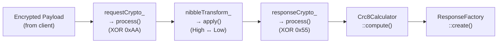

| Operation | Class | Formula | Example |
|-----------|-------|---------|---------|
| **Decrypt** | `XorCryptoStrategy(0xAA)` | `plain[i] = encrypted[i] XOR 0xAA` | `0xB8 XOR 0xAA = 0x12` |
| **Nibble Swap** | `NibbleSwapTransform` | `swapped[i] = (plain[i] << 4) \| (plain[i] >> 4)` | `0x12 → 0x21` |
| **Re-encrypt** | `XorCryptoStrategy(0x55)` | `response[i] = swapped[i] XOR 0x55` | `0x21 XOR 0x55 = 0x74` |

---

### 4.4 Response Layer (Frame Construction)

Assembles correctly formatted response frames using the **Factory Method** pattern.

| Response Type | Factory Product | Structure | Total Size |
|---------------|-----------------|-----------|------------|
| **Positive** | `PositiveResponse` | SA(2B) + TA(2B) + Length(4B) + EncryptedPayload(NB) + CRC(1B) | 9 + N bytes |
| **Negative** | `NegativeResponse` | SA(2B) + TA(2B) + Length(4B) + FailureCode(1B) + CRC(1B) | 10 bytes |

> [!IMPORTANT]
> In responses, Source and Target addresses are **swapped** relative to the request. The response SA = request TA, and the response TA = request SA.

---

## 5. Detailed Component Architecture

### 5.1 Class Hierarchy Diagram

```mermaid
classDiagram
    class ISocket {
        <<interface>>
        +send(data: const uint8_t*, len: size_t) int
        +recv(buffer: uint8_t*, len: size_t) ssize_t
        +close() void
    }

    class ICryptoStrategy {
        <<interface>>
        +process(data: uint8_t*, length: size_t) void
        +getKey() uint8_t
    }

    class ITransform {
        <<interface>>
        +apply(data: uint8_t*, length: size_t) void
    }

    class IValidationHandler {
        <<interface>>
        +setNext(handler: IValidationHandler*) IValidationHandler*
        +validate(packet: const Packet&) FailureCode
    }

    class IResponseBuilder {
        <<interface>>
        +build(request: const Packet&, payload: const vector~uint8_t~) vector~uint8_t~
    }

    class PlatformSocket {
        -handle_: gw_socket_t
        +send() int
        +recv() ssize_t
        +close() void
    }

    class XorCryptoStrategy {
        -key_: uint8_t
        +process() void
        +getKey() uint8_t
    }

    class NibbleSwapTransform {
        +apply() void
    }

    class LengthValidator {
        -next_: IValidationHandler*
        +validate() FailureCode
    }
    class SourceAddressValidator {
        -next_: IValidationHandler*
        +validate() FailureCode
    }
    class TargetAddressValidator {
        -next_: IValidationHandler*
        +validate() FailureCode
    }
    class CrcValidator {
        -next_: IValidationHandler*
        -calculator_: Crc8Calculator&
        +validate() FailureCode
    }

    class PositiveResponseBuilder {
        -crypto_: ICryptoStrategy&
        -crc_: Crc8Calculator&
        +build() vector~uint8_t~
    }
    class NegativeResponseBuilder {
        -crc_: Crc8Calculator&
        +build() vector~uint8_t~
    }

    ISocket <|.. PlatformSocket : implements
    ICryptoStrategy <|.. XorCryptoStrategy : implements
    ITransform <|.. NibbleSwapTransform : implements
    IValidationHandler <|.. LengthValidator : implements
    IValidationHandler <|.. SourceAddressValidator : implements
    IValidationHandler <|.. TargetAddressValidator : implements
    IValidationHandler <|.. CrcValidator : implements
    IResponseBuilder <|.. PositiveResponseBuilder : implements
    IResponseBuilder <|.. NegativeResponseBuilder : implements
```

### 5.2 Server Processing Pipeline (Template Method)

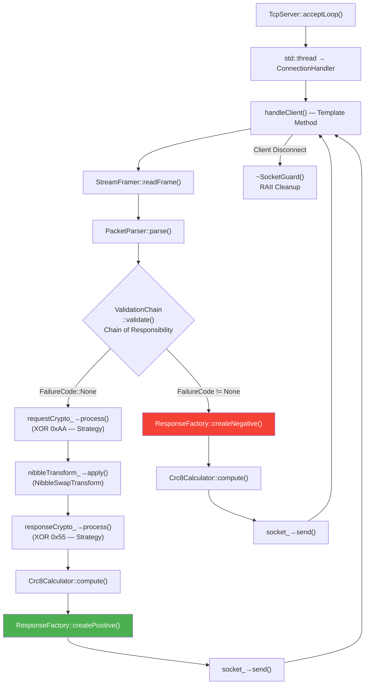

### 5.3 Client Request/Response Pipeline

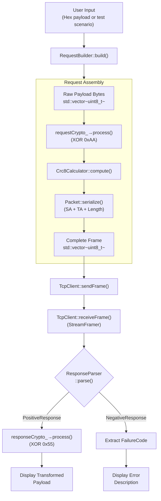

### 5.4 Concurrency Model

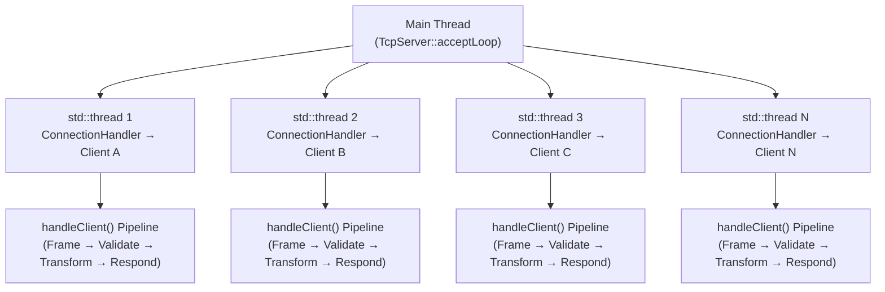

- Each worker thread runs an **independent, isolated pipeline** — no shared mutable state between connections
- The main thread only accepts connections and dispatches; all processing happens in `std::thread` worker threads
- `std::atomic` counters in `ServerMetrics` (Singleton/Observer) are the only shared state — lock-free, thread-safe
- Socket handles managed via `SocketGuard` (RAII) — auto-closes on scope exit or exception

---

## 6. Component Responsibilities & Key Interfaces

### 6.1 Packet (`Packet` class)

| Aspect | Detail |
|--------|--------|
| **Role** | Immutable value object representing a parsed protocol frame |
| **Shared By** | Both `gw_server` and `gw_client` |
| **Pattern** | Value Object |

```cpp
// Rule of Zero — std::vector member self-manages; compiler-generated
// copy/move/destructor are correct for this value-object class.
class Packet {
public:
    Packet(uint16_t sourceAddr, uint16_t targetAddr, uint32_t length,
           std::vector<uint8_t> payload, uint8_t crc);

    // No destructor, copy, or move declarations needed (Rule of Zero)

    uint16_t sourceAddr() const;
    uint16_t targetAddr() const;
    uint32_t length() const;
    uint32_t payloadLen() const;         // length - 1
    const std::vector<uint8_t>& payload() const;
    uint8_t crc() const;

    std::vector<uint8_t> serialize() const;

private:
    uint16_t sourceAddr_;
    uint16_t targetAddr_;
    uint32_t length_;
    std::vector<uint8_t> payload_;
    uint8_t crc_;
};
```

---

### 6.2 StreamFramer (`StreamFramer` class)

| Aspect | Detail |
|--------|--------|
| **Role** | Reliable two-phase TCP byte stream framing — converts unstructured byte stream into discrete protocol frames |
| **Shared By** | Both `gw_server` and `gw_client` |

```cpp
class StreamFramer {
public:
    // Read exactly 'count' bytes from socket (handles partial reads)
    static ssize_t recvExact(ISocket& socket, uint8_t* buffer, size_t count);

    // Read one complete frame: 8B header → extract Length → read Length bytes
    static std::vector<uint8_t> readFrame(ISocket& socket);
};
```

**Framing Protocol:**
```
Step 1: Read exactly 8 bytes (Header) → Extract Length (uint32, big-endian)
Step 2: Read exactly Length bytes       → [Encrypted Payload (N) + CRC (1)]
Total Packet Size = 8 + Length bytes
```

---

### 6.3 PacketParser (`PacketParser` class)

| Aspect | Detail |
|--------|--------|
| **Role** | Extracts structured fields from a raw frame buffer into a `Packet` object |
| **Shared By** | Both `gw_server` and `gw_client` |

```cpp
class PacketParser {
public:
    // Parse raw buffer into a Packet object (big-endian field extraction)
    static Packet parse(const std::vector<uint8_t>& frameData);
};
```

---

### 6.4 Validation Chain (Chain of Responsibility)

| Aspect | Detail |
|--------|--------|
| **Role** | 4-stage fail-fast validation of incoming request packets |
| **Used By** | `gw_server` only |
| **Pattern** | Chain of Responsibility |

```cpp
// Abstract handler (interface — virtual destructor for polymorphic deletion)
class IValidationHandler {
public:
    virtual ~IValidationHandler() = default;

    // Rule of Zero — interface has no resources to manage
    // (virtual dtor is for safe polymorphic deletion, not resource cleanup)

    virtual IValidationHandler* setNext(IValidationHandler* handler) = 0;
    virtual FailureCode validate(const Packet& packet) const = 0;
};

// Base implementation with chaining logic
// Rule of Zero — stores only non-owning IValidationHandler* pointer
class BaseValidator : public IValidationHandler {
public:
    IValidationHandler* setNext(IValidationHandler* handler) override;
    FailureCode validate(const Packet& packet) const override;
protected:
    virtual FailureCode doValidate(const Packet& packet) const = 0;
private:
    IValidationHandler* next_ = nullptr;   // non-owning (chain does not own its successors)
};

// Concrete validators — all follow Rule of Zero (no resources to manage)
class LengthValidator       : public BaseValidator { /* doValidate() only */ };
class SourceAddressValidator : public BaseValidator { /* doValidate() only */ };
class TargetAddressValidator : public BaseValidator { /* doValidate() only */ };
class CrcValidator           : public BaseValidator {
    // Rule of Zero — stores const Crc8Calculator& (non-owning reference)
    const Crc8Calculator& calculator_;
    /* doValidate() only */
};
```

**Validation Precedence (short-circuits at first failure):**

| Stage | Validator Class | Failure Code | Condition |
|-------|----------------|-------------|-----------|
| 1 | `LengthValidator` | `FailureCode::LengthMismatch` (`0x08`) | `total_len < 9` OR `total_len != 8 + length_field` |
| 2 | `SourceAddressValidator` | `FailureCode::SourceAddrInvalid` (`0x01`) | SA ∉ {`0x0E80`, `0xE008`} |
| 3 | `TargetAddressValidator` | `FailureCode::TargetAddrInvalid` (`0x02`) | TA ∉ {`0x3108`, `0x1380`} |
| 4 | `CrcValidator` | `FailureCode::IntegrityFailure` (`0x04`) | `CRC-8(encrypted_payload) != received_crc` |

**Chain Assembly:**
```cpp
// In GatewayServer (Facade) initialization
auto lengthValidator = std::make_unique<LengthValidator>();
auto saValidator     = std::make_unique<SourceAddressValidator>();
auto taValidator     = std::make_unique<TargetAddressValidator>();
auto crcValidator    = std::make_unique<CrcValidator>(crc8Calculator_);

lengthValidator->setNext(saValidator.get())
               ->setNext(taValidator.get())
               ->setNext(crcValidator.get());
```

---

### 6.5 Crypto Strategy (Strategy Pattern)

| Aspect | Detail |
|--------|--------|
| **Role** | Pluggable encryption/decryption of payload buffers |
| **Shared By** | Both `gw_server` and `gw_client` |
| **Pattern** | Strategy |

```cpp
// Strategy interface (virtual destructor for polymorphic deletion)
class ICryptoStrategy {
public:
    virtual ~ICryptoStrategy() = default;

    // Rule of Zero — interface has no resources

    virtual void process(uint8_t* data, size_t length) const = 0;
    virtual uint8_t getKey() const = 0;
};

// Concrete strategy: XOR encryption
// Rule of Zero — only const scalar member; trivially copyable
class XorCryptoStrategy : public ICryptoStrategy {
public:
    explicit XorCryptoStrategy(uint8_t key);

    void process(uint8_t* data, size_t length) const override;  // Command: modifies buffer
    uint8_t getKey() const override;                             // Query: returns key

    // No destructor, copy, or move declarations needed (Rule of Zero)

private:
    const uint8_t key_;
};
```

| Context | Instance | Key | Purpose |
|---------|----------|-----|---------|
| Request decryption | `XorCryptoStrategy(0xAA)` | `0xAA` | Decrypt inbound request payload |
| Response encryption | `XorCryptoStrategy(0x55)` | `0x55` | Encrypt outbound response payload |

---

### 6.6 Crc8Calculator

| Aspect | Detail |
|--------|--------|
| **Role** | Compute CRC-8 checksums for integrity verification and response generation |
| **Shared By** | Both `gw_server` and `gw_client` |
| **Algorithm** | CRC-8 with polynomial `0x07`, initial value `0x00` |

```cpp
// Rule of Zero — only const scalar members; trivially copyable
class Crc8Calculator {
public:
    explicit Crc8Calculator(uint8_t polynomial = 0x07, uint8_t initialValue = 0x00);

    uint8_t compute(const uint8_t* data, size_t length) const;   // Query: pure function
    uint8_t compute(const std::vector<uint8_t>& data) const;     // Query: pure function

    // No destructor, copy, or move declarations needed (Rule of Zero)

private:
    const uint8_t polynomial_;
    const uint8_t initialValue_;
};
```

---

### 6.7 NibbleSwapTransform

| Aspect | Detail |
|--------|--------|
| **Role** | Swap high and low nibbles of each byte in the payload buffer |
| **Used By** | `gw_server` (core transformation step) |
| **Pattern** | Strategy (implements `ITransform`) |

```cpp
// Interface (virtual destructor for polymorphic deletion)
class ITransform {
public:
    virtual ~ITransform() = default;

    // Rule of Zero — interface has no resources

    virtual void apply(uint8_t* data, size_t length) const = 0;  // Command: in-place transform
};

// Rule of Zero — stateless class; no data members
class NibbleSwapTransform : public ITransform {
public:
    void apply(uint8_t* data, size_t length) const override;
    // For each byte: result = ((byte & 0x0F) << 4) | ((byte & 0xF0) >> 4)

    // No destructor, copy, or move declarations needed (Rule of Zero)
};
```

---

### 6.8 ResponseFactory (Factory Method)

| Aspect | Detail |
|--------|--------|
| **Role** | Create correctly formatted Positive and Negative response frames |
| **Used By** | `gw_server` only |
| **Pattern** | Factory Method |

```cpp
// Rule of Zero — stores only const references (non-owning); no resources
class ResponseFactory {
public:
    ResponseFactory(const ICryptoStrategy& responseCrypto, const Crc8Calculator& crc);

    // Factory Method: creates the appropriate response based on failure code
    std::vector<uint8_t> create(const Packet& request,
                                FailureCode failureCode,
                                const std::vector<uint8_t>& transformedPayload = {}) const;

    // No destructor, copy, or move declarations needed (Rule of Zero)

private:
    std::vector<uint8_t> buildPositive(const Packet& req,
                                       const std::vector<uint8_t>& payload) const;
    std::vector<uint8_t> buildNegative(const Packet& req, FailureCode code) const;

    const ICryptoStrategy& crypto_;
    const Crc8Calculator& crc_;
};
```

---

### 6.9 ConnectionHandler (Template Method)

| Aspect | Detail |
|--------|--------|
| **Role** | Per-connection worker — orchestrates the full request → response pipeline |
| **Used By** | `gw_server` only |
| **Pattern** | Template Method |

```cpp
// Rule of Five — owns std::unique_ptr<ISocket> (move-only resource)
class ConnectionHandler {
public:
    ConnectionHandler(std::unique_ptr<ISocket> socket,
                      const IValidationHandler& validator,
                      const ICryptoStrategy& requestCrypto,
                      const ICryptoStrategy& responseCrypto,
                      const ITransform& transform,
                      const Crc8Calculator& crc,
                      ServerMetrics& metrics);

    // Rule of Five: move-only (unique_ptr member makes copy impossible)
    ~ConnectionHandler() = default;
    ConnectionHandler(const ConnectionHandler&) = delete;
    ConnectionHandler& operator=(const ConnectionHandler&) = delete;
    ConnectionHandler(ConnectionHandler&&) = default;
    ConnectionHandler& operator=(ConnectionHandler&&) = default;

    // Template Method: defines the algorithm skeleton
    void handleClient();

private:
    // Steps (called by handleClient in fixed order — Small Functions principle)
    std::vector<uint8_t> readFrame();
    Packet               parseFrame(const std::vector<uint8_t>& data);
    FailureCode          validatePacket(const Packet& packet);
    std::vector<uint8_t> transformPayload(const Packet& packet);
    std::vector<uint8_t> buildResponse(const Packet& req, FailureCode code,
                                        const std::vector<uint8_t>& payload);
    void                 sendResponse(const std::vector<uint8_t>& frame);

    std::unique_ptr<ISocket> socket_;          // RAII-managed (owned resource)
    const IValidationHandler& validator_;       // Dependency Injection (non-owning)
    const ICryptoStrategy& requestCrypto_;      // Dependency Injection (non-owning)
    const ICryptoStrategy& responseCrypto_;     // Dependency Injection (non-owning)
    const ITransform& transform_;               // Dependency Injection (non-owning)
    const Crc8Calculator& crc_;                 // Dependency Injection (non-owning)
    ServerMetrics& metrics_;                    // Observer (non-owning)
};
```

---

### 6.10 GatewayServer (Facade)

| Aspect | Detail |
|--------|--------|
| **Role** | Top-level entry point — wires all subsystems and exposes simple `start()` / `stop()` |
| **Used By** | `gw_server` `main()` |
| **Pattern** | Facade |

```cpp
// Rule of Five — owns threads, validators (unique_ptr), atomic state; non-copyable, non-movable
class GatewayServer {
public:
    explicit GatewayServer(uint16_t port = 13400);
    ~GatewayServer();   // Calls stop(), joins all worker threads

    void start();   // Initializes platform, binds, listens, enters accept loop
    void stop();    // Signals shutdown, joins all worker threads

    // Rule of Five: non-copyable, non-movable (owns threads + atomic state)
    GatewayServer(const GatewayServer&) = delete;
    GatewayServer& operator=(const GatewayServer&) = delete;
    GatewayServer(GatewayServer&&) = delete;
    GatewayServer& operator=(GatewayServer&&) = delete;

private:
    TcpServer tcpServer_;
    Crc8Calculator crc_;
    XorCryptoStrategy requestCrypto_{0xAA};
    XorCryptoStrategy responseCrypto_{0x55};
    NibbleSwapTransform nibbleSwap_;

    // Validation chain (owned)
    std::unique_ptr<LengthValidator>       lengthValidator_;
    std::unique_ptr<SourceAddressValidator> saValidator_;
    std::unique_ptr<TargetAddressValidator> taValidator_;
    std::unique_ptr<CrcValidator>           crcValidator_;

    std::vector<std::thread> workerThreads_;
    std::atomic<bool> running_{false};
};
```

---

### 6.11 ServerMetrics (Singleton + Observer)

| Aspect | Detail |
|--------|--------|
| **Role** | Thread-safe operational telemetry via `std::atomic` counters |
| **Used By** | `gw_server` only |
| **Pattern** | Singleton + Observer |

```cpp
// Rule of Five — Singleton: non-copyable, non-movable
class ServerMetrics {
public:
    static ServerMetrics& instance();

    // Observer notifications (Commands: modify atomic counters)
    void onRequestReceived();
    void onPositiveResponse();
    void onNegativeResponse(FailureCode code);
    void onClientConnected();
    void onClientDisconnected();

    // Accessors (Queries: const, thread-safe reads)
    uint64_t totalRequests() const;
    uint64_t positiveResponses() const;
    uint64_t negativeCount(FailureCode code) const;
    uint32_t activeConnections() const;
    uint64_t totalConnections() const;

    void dump() const;  // Log current metrics snapshot

    // Rule of Five: Singleton — delete ALL copy and move operations
    ServerMetrics(const ServerMetrics&) = delete;
    ServerMetrics& operator=(const ServerMetrics&) = delete;
    ServerMetrics(ServerMetrics&&) = delete;
    ServerMetrics& operator=(ServerMetrics&&) = delete;

private:
    ServerMetrics() = default;   // Private constructor (Singleton)
    std::atomic<uint64_t> totalRequests_{0};
    std::atomic<uint64_t> positiveResponses_{0};
    std::atomic<uint64_t> negative0x01_{0};
    std::atomic<uint64_t> negative0x02_{0};
    std::atomic<uint64_t> negative0x04_{0};
    std::atomic<uint64_t> negative0x08_{0};
    std::atomic<uint32_t> activeConnections_{0};
    std::atomic<uint64_t> totalConnections_{0};
};
```

---

### 6.12 Logger (Singleton)

| Aspect | Detail |
|--------|--------|
| **Role** | Thread-safe structured logging with severity levels and hex dump support |
| **Shared By** | Both `gw_server` and `gw_client` |
| **Pattern** | Singleton |

```cpp
enum class LogLevel { DEBUG, INFO, WARN, ERROR };

// Rule of Five — Singleton: non-copyable, non-movable
class Logger {
public:
    static Logger& instance();

    void setLevel(LogLevel level);              // Command: changes log level
    void log(LogLevel level, const std::string& module, const std::string& message);
    void hexDump(LogLevel level, const std::string& module,
                 const std::string& label, const uint8_t* data, size_t length);

    // Rule of Five: Singleton — delete ALL copy and move operations
    Logger(const Logger&) = delete;
    Logger& operator=(const Logger&) = delete;
    Logger(Logger&&) = delete;
    Logger& operator=(Logger&&) = delete;

private:
    Logger() = default;          // Private constructor (Singleton)
    LogLevel level_ = LogLevel::INFO;
    std::mutex mutex_;           // Thread-safe output (non-copyable, non-movable)
};
```

---

## 7. Data Flow & Sequence Diagrams

### 7.1 End-to-End Positive Response Flow

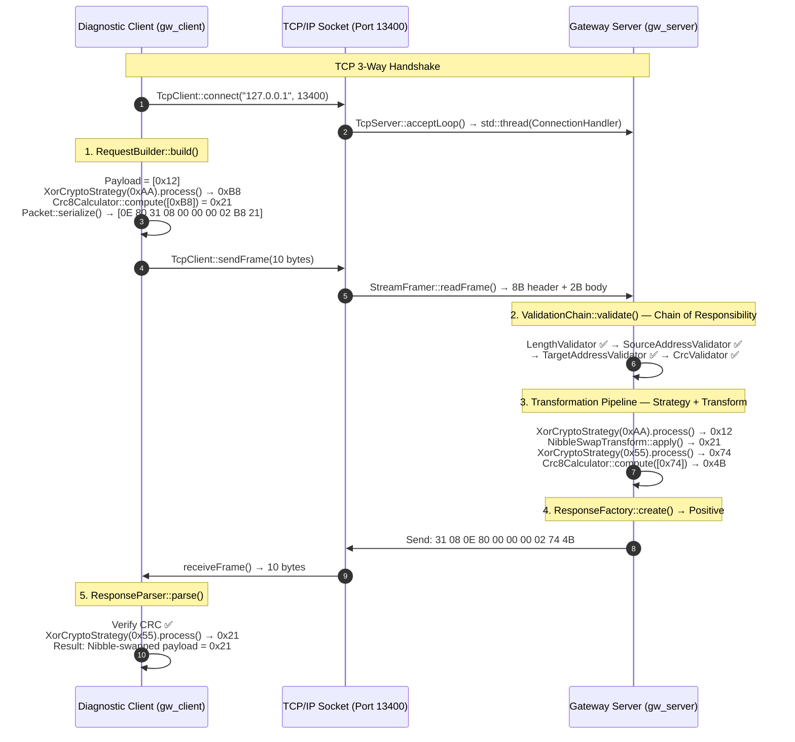

### 7.2 Negative Response Flow (Validation Failure)

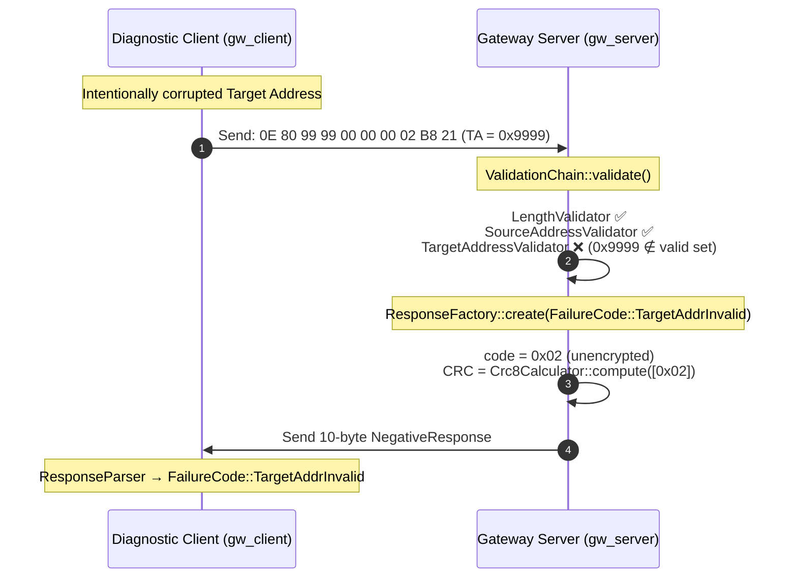

### 7.3 Multi-Client Concurrent Processing

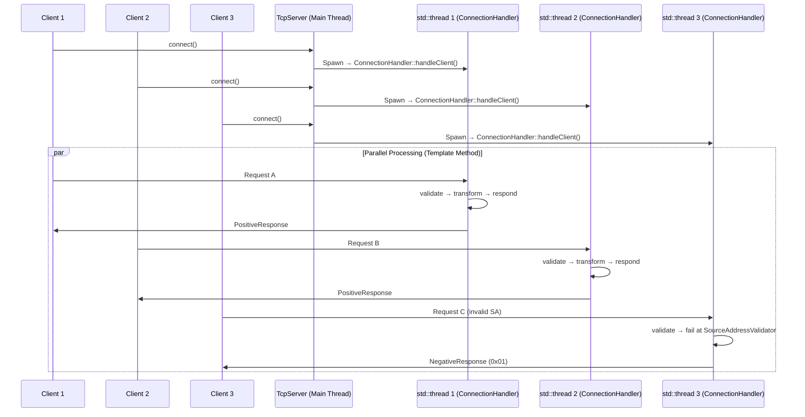

### 7.4 End-to-End Test Vector Trace

| Step | Operation | Value | Binary |
|:-----|:----------|:-----:|:------:|
| Client Input | Raw payload | `0x12` | `0001 0010` |
| Client Transmit | `XorCryptoStrategy(0xAA).process()` | `0xB8` | `1011 1000` |
| Server Receive | `XorCryptoStrategy(0xAA).process()` | `0x12` | `0001 0010` |
| Server Transform | `NibbleSwapTransform::apply()` | `0x21` | `0010 0001` |
| Server Transmit | `XorCryptoStrategy(0x55).process()` | `0x74` | `0111 0100` |
| Client Receive | `XorCryptoStrategy(0x55).process()` | `0x21` | `0010 0001` |

---

## 8. Technology Stack

### 8.1 Complete Technology Map

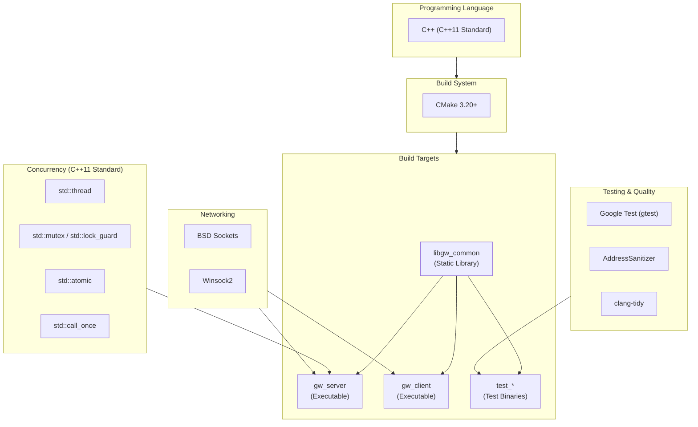

### 8.2 Stack Breakdown

| Component | Choice | Rationale |
|-----------|--------|-----------|
| **Programming Language** | C++11 | OOP support (classes, inheritance, polymorphism), RAII, `std::thread`, `std::atomic`, `std::vector`, `enum class`, smart pointers, type safety |
| **Build System** | CMake 3.20+ | Multi-target build management (`libgw_common`, `gw_server`, `gw_client`, unit tests) across Windows and Linux |
| **Threading** | `std::thread` (C++11) | Portable, standard-library threading — no platform-specific pthread/Win32 API in business logic |
| **Synchronization** | `std::mutex`, `std::lock_guard`, `std::atomic`, `std::call_once` | C++11 standard concurrency primitives; lock-free atomics for metrics counters |
| **Smart Pointers** | `std::unique_ptr`, `std::shared_ptr` | RAII-based lifetime management; no manual `new`/`delete` in application code |
| **Containers** | `std::vector<uint8_t>`, `std::array`, `std::string` | Bounds-safe, size-aware containers replace raw C arrays |
| **Networking API** | BSD Sockets / Winsock2 | Wrapped behind `PlatformSocket` adapter; hidden from business logic |
| **Testing Framework** | Google Test (gtest) | Industry-standard C++ testing with fixtures, parameterized tests, mocking support |
| **Static Analysis** | clang-tidy | Code quality, modernization checks (C++11 best practices), bug detection |
| **Memory Safety** | AddressSanitizer (ASan) | Memory leak detection, buffer overflow detection, use-after-free detection |
| **Byte Order** | Big-endian wire format | Network byte order for all multi-byte header fields |

---

## 9. Security Architecture & Principles

### 9.1 Security Architecture

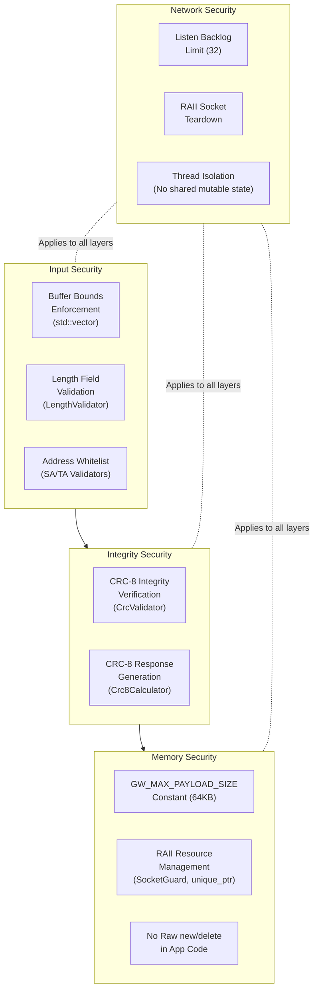

### 9.2 Security Principles

| Layer | Principle | Implementation |
|-------|-----------|----------------|
| **Input** | Never trust incoming data | 4-stage validation chain before any processing; length field verified before buffer access |
| **Memory** | RAII everywhere | `SocketGuard`, `std::unique_ptr`, `std::lock_guard` — no manual resource release; `std::vector` replaces raw arrays |
| **Bounds** | Bounded buffers only | `GW_MAX_PAYLOAD_SIZE` (64KB) hard limit; `std::vector::resize()` with cap check |
| **Integrity** | Verify before processing | CRC-8 checked via `CrcValidator`; CRC-8 computed for every outbound packet |
| **Addresses** | Whitelist-only acceptance | Only `0x0E80`, `0xE008` (source) and `0x3108`, `0x1380` (target) accepted |
| **Concurrency** | Isolated worker threads | No shared mutable state between `ConnectionHandler` instances; `ServerMetrics` uses `std::atomic` |
| **Crypto** | Separate key domains | Request key (`0xAA`) and response key (`0x55`) are distinct `XorCryptoStrategy` instances |
| **Failure Codes** | Never encrypt error info | Failure codes in negative responses are transmitted in plaintext |
| **Type Safety** | Scoped enums and const correctness | `enum class FailureCode` prevents implicit int conversion; `const` on all read-only parameters and methods |

### 9.3 Threat Mitigations

| Threat | Risk | Mitigation |
|--------|------|------------|
| **Buffer overflow via large Length field** | High | `GW_MAX_PAYLOAD_SIZE` cap; length validated by `LengthValidator` before body read; `std::vector` bounds-checked |
| **Invalid address injection** | Medium | Strict address whitelist in `SourceAddressValidator` and `TargetAddressValidator` |
| **CRC collision / payload tampering** | Low | CRC-8 detects single-bit errors; `CrcValidator` fail-fast on integrity failure |
| **Connection flooding (DoS)** | Medium | Listen backlog limit; `SocketGuard` RAII ensures clean teardown per thread |
| **Resource leak on exception** | Low | All resources (sockets, threads, memory) managed via RAII — destructors guarantee cleanup |
| **Data corruption across connections** | Low | Complete thread isolation; each `ConnectionHandler` has its own `std::unique_ptr<ISocket>` |

---

## 10. Error Handling Strategy

### 10.1 Error Handling Architecture

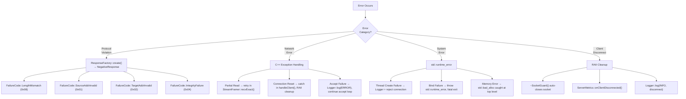

### 10.2 Error Categories & Responses

| Category | Trigger | Server Action | Client Visibility |
|----------|---------|---------------|-------------------|
| **Length Mismatch** | Frame size ≠ 8 + length field | `NegativeResponse` with `FailureCode::LengthMismatch` | Client receives explicit error code |
| **Invalid Source Address** | SA ∉ {`0x0E80`, `0xE008`} | `NegativeResponse` with `FailureCode::SourceAddrInvalid` | Client receives explicit error code |
| **Invalid Target Address** | TA ∉ {`0x3108`, `0x1380`} | `NegativeResponse` with `FailureCode::TargetAddrInvalid` | Client receives explicit error code |
| **CRC Integrity Failure** | Computed CRC ≠ received CRC | `NegativeResponse` with `FailureCode::IntegrityFailure` | Client receives explicit error code |
| **Client Disconnect** | TCP RST or orderly close | `~SocketGuard()` RAII auto-cleanup | N/A |
| **Partial TCP Read** | Fewer bytes than expected | `StreamFramer::recvExact()` loops until complete | Transparent to client |
| **Server Bind Failure** | Port 13400 already in use | `throw std::runtime_error` → fatal exit with message | Server does not start |

### 10.3 Error Handling Principles

- ✅ **RAII-Safe:** All cleanup happens in destructors — no `finally` blocks or manual `close()` calls
- ✅ **Exception-Aware:** Network errors caught per-connection; one failing client never crashes the server
- ✅ **Specific:** Every failure code maps to exactly one validation stage via `enum class FailureCode`
- ✅ **Deterministic:** Same invalid input always produces the same failure code
- ✅ **Fail-Fast:** First validation failure in the chain short-circuits — no unnecessary processing
- ✅ **Never Silent:** Every request receives a response — positive or negative
- ✅ **Logged:** Every error is logged via `Logger::instance()` with timestamp, severity, and context

---

## 11. Monitoring & Logging Strategy

### 11.1 Structured Logging Architecture

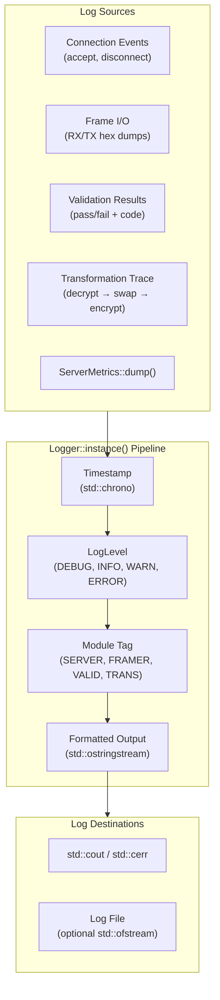

### 11.2 Log Format Specification

```
[2026-11-14 11:15:02.102] [INFO ] [SERVER] Client connected from 127.0.0.1:58422
[2026-11-14 11:15:02.103] [DEBUG] [FRAMER] RX: 0E 80 31 08 00 00 00 02 B8 21 (10 bytes)
[2026-11-14 11:15:02.103] [INFO ] [VALID ] Request validated successfully (SA=0x0E80, TA=0x3108)
[2026-11-14 11:15:02.103] [DEBUG] [TRANS ] Decrypt: [12] -> Swap: [21] -> Encrypt: [74] -> CRC: [4B]
[2026-11-14 11:15:02.104] [DEBUG] [FRAMER] TX: 31 08 0E 80 00 00 00 02 74 4B (10 bytes)
[2026-11-14 11:15:02.104] [INFO ] [SERVER] Positive response delivered
```

### 11.3 Log Levels

| Level | `enum class LogLevel` | Usage | Examples |
|-------|----------------------|-------|---------|
| **ERROR** | `LogLevel::ERROR` | Unrecoverable failures | Bind failure, thread creation failure |
| **WARN** | `LogLevel::WARN` | Recoverable anomalies | Validation failure, partial read retry |
| **INFO** | `LogLevel::INFO` | Operational events | Client connect/disconnect, request processed |
| **DEBUG** | `LogLevel::DEBUG` | Wire-level detail | Hex dumps of RX/TX frames, transformation trace |

### 11.4 Server Metrics Dashboard (via `ServerMetrics::dump()`)

| Metric | `std::atomic` Type | Update Frequency |
|--------|-------------------|-----------------|
| Total requests received | `std::atomic<uint64_t>` | Per request |
| Positive responses sent | `std::atomic<uint64_t>` | Per positive response |
| Negative responses by code | `std::atomic<uint64_t>` (×4) | Per negative response |
| Active connections | `std::atomic<uint32_t>` | Per connect/disconnect |
| Cumulative connections | `std::atomic<uint64_t>` | Per connect |

---

## 12. Scalability Strategy

### 12.1 Concurrency Architecture

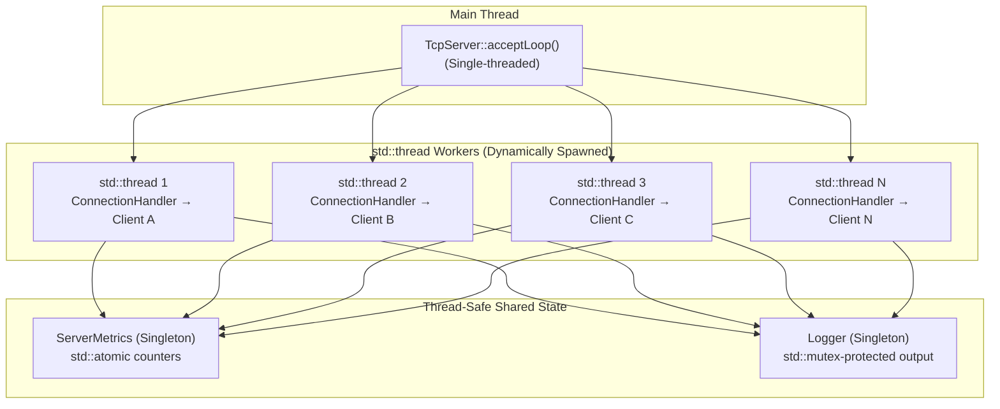

### 12.2 Scalability Dimensions

| Dimension | Strategy | Mechanism |
|-----------|----------|-----------|
| **Concurrent Clients** | Thread-per-connection | Each connection gets a dedicated `std::thread`; no request queuing |
| **Throughput** | In-place processing | XOR and nibble-swap operate on `std::vector::data()` in-place |
| **Memory** | RAII-managed buffers | `std::vector<uint8_t>` auto-resizes and auto-frees; no heap fragmentation |
| **Listen Queue** | Configurable backlog | `listen(sock, backlog)` with tunable depth (default: 32) |
| **Connection Limits** | OS thread/fd limits | Scales to OS limits (typically 1000+ concurrent connections) |
| **Thread Safety** | Lock-free metrics | `std::atomic` for all counters — no mutex contention on the hot path |

### 12.3 Performance Characteristics

| Metric | Expected Value | Bottleneck |
|--------|---------------|------------|
| Per-request latency | < 1 ms | CPU-bound (XOR + nibble swap + CRC) |
| Connection setup time | < 5 ms | TCP handshake + `std::thread` construction |
| Max concurrent clients | OS-limited (1000+) | Thread count / file descriptors |
| Memory per connection | ~70 KB | Thread stack + `std::vector` buffer |
| Throughput (single client) | ~100K req/sec | Socket I/O bound |

---

## 13. Testing & Evaluation Strategy

### 13.1 Test Architecture

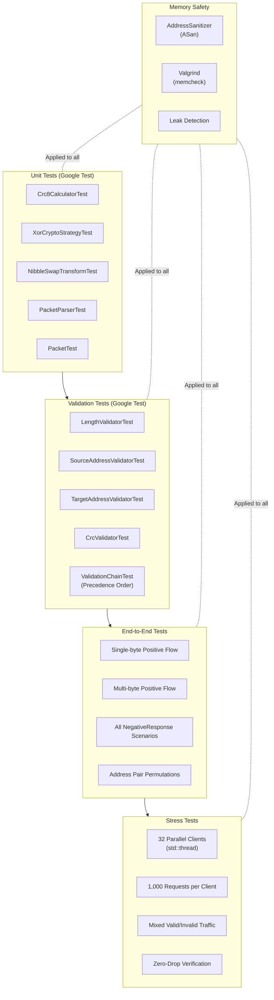

### 13.2 Test Matrix

| Test Suite | Target | Framework | Purpose |
|:-----------|:-------|:----------|:--------|
| **Unit Tests** | `libgw_common` classes | Google Test | Verify `Crc8Calculator`, `XorCryptoStrategy`, `NibbleSwapTransform`, `PacketParser`, `Packet` in isolation |
| **Validation Tests** | Validator chain | Google Test | Validate strict precedence order for all `FailureCode` values (0x08 → 0x01 → 0x02 → 0x04); test each validator independently + full chain |
| **Integration Tests** | `ResponseFactory`, `ConnectionHandler` | Google Test + mock `ISocket` | Verify response frame construction and pipeline orchestration with mocked socket I/O |
| **End-to-End System** | `gw_server` + `gw_client` | Google Test | Full TCP socket roundtrip for all problem statement test cases |
| **Stress & Concurrency** | `gw_server` | Google Test | Spawn 32 parallel clients sending 1,000 requests each; verify zero dropped requests |
| **Memory Safety** | Both binaries | Valgrind / ASan | Ensure zero leaks, zero buffer overflows, zero use-after-free |

### 13.3 Golden Test Vectors

| # | Scenario | Input Payload | Expected Result | Key Validation |
|---|----------|--------------|----------------|----------------|
| 1 | Single-byte valid | `[0x12]` | Positive: `[0x21]` (nibble-swapped) | End-to-end transformation correctness |
| 2 | Multi-byte valid | `[0x12, 0x34, 0xAB]` | Positive: `[0x21, 0x43, 0xBA]` | Multi-byte processing |
| 3 | All-zeros payload | `[0x00]` | Positive: `[0x00]` (unchanged by swap) | Edge case: symmetric nibbles |
| 4 | All-ones payload | `[0xFF]` | Positive: `[0xFF]` (unchanged by swap) | Edge case: symmetric nibbles |
| 5 | Invalid Source Address | SA = `0xFFFF` | Negative: `0x01` | `SourceAddressValidator` whitelist |
| 6 | Invalid Target Address | TA = `0x9999` | Negative: `0x02` | `TargetAddressValidator` whitelist |
| 7 | Corrupted CRC | CRC byte flipped | Negative: `0x04` | `CrcValidator` integrity detection |
| 8 | Length mismatch | Length field ≠ actual body | Negative: `0x08` | `LengthValidator` consistency check |
| 9 | SA=0xE008, TA=0x1380 | `[0x56]` | Positive: `[0x65]` | Alternate address pair validation |
| 10 | Dual failure (SA + CRC) | Invalid SA + bad CRC | Negative: `0x01` (not `0x04`) | Chain of Responsibility precedence: SA checked before CRC |

### 13.4 Performance Benchmarks

| Metric | Target | Measurement Method |
|--------|--------|--------------------|
| Single-request latency | < 1 ms | Integration test with `std::chrono` timing |
| Throughput (single client) | > 50K req/sec | Stress test with 1 client, 100K requests |
| Concurrent client handling | 32+ simultaneous | Stress test with 32 `std::thread` clients |
| Zero-drop rate | 100% response rate | Count sent vs. received in stress test |
| Memory leak | 0 bytes leaked | Valgrind / ASan after full test suite |
| Buffer overflow | 0 detected | ASan across all test suites |

### 13.5 Testability via Design Patterns

| Pattern | Testability Benefit |
|---------|---------------------|
| **Dependency Injection** | `ConnectionHandler` accepts `IValidator&`, `ICryptoStrategy&`, `ITransform&` via constructor — all can be mocked/stubbed in unit tests |
| **Strategy** | `ICryptoStrategy` can be replaced with a no-op or recording mock to test pipeline logic without real crypto |
| **Chain of Responsibility** | Each validator can be tested independently; chain ordering tested separately |
| **Interface Segregation** | Mock only the interface each test needs — no god-object mocks |
| **Factory Method** | `ResponseFactory` tested with known inputs → deterministic byte-level output verification |

---

## 14. Project Directory Structure

```
GW Network packet communication_cpp/
├── docs/                                        # Documentation
│   ├── GW_Requirement_Specification.docx        # Original Word requirement document
│   ├── problemStatement.md                      # Enhanced problem statement & protocol spec
│   ├── architecture.md                          # This architecture document (C++11 / OOP / SOLID)
│   └── prompt.md                                # Task prompt history
│
├── include/                                     # Public Header Files (.hpp)
│   ├── common/                                  # ── Shared Types, Crypto, Framing & Platform ──
│   │   ├── gw_types.hpp                         # enum class FailureCode, ResponseType, address constants
│   │   ├── gw_config.hpp                        # constexpr port, buffer limits, timeout constants
│   │   ├── platform_socket.hpp                  # PlatformSocket class (ISocket adapter: Winsock/POSIX)
│   │   ├── socket_guard.hpp                     # SocketGuard RAII wrapper for socket handles
│   │   ├── logger.hpp                           # Logger singleton class declaration
│   │   ├── crc8_calculator.hpp                  # Crc8Calculator class declaration
│   │   ├── i_crypto_strategy.hpp                # ICryptoStrategy abstract interface
│   │   ├── xor_crypto_strategy.hpp              # XorCryptoStrategy concrete class
│   │   ├── i_transform.hpp                      # ITransform abstract interface
│   │   ├── nibble_swap_transform.hpp            # NibbleSwapTransform concrete class
│   │   ├── packet.hpp                           # Packet value-object class
│   │   ├── packet_parser.hpp                    # PacketParser static parser class
│   │   └── stream_framer.hpp                    # StreamFramer static framing class
│   │
│   ├── server/                                  # ── Gateway Server Headers ──
│   │   ├── gateway_server.hpp                   # GatewayServer facade class
│   │   ├── tcp_server.hpp                       # TcpServer class (bind, listen, accept)
│   │   ├── connection_handler.hpp               # ConnectionHandler class (Template Method)
│   │   ├── i_validation_handler.hpp             # IValidationHandler abstract interface
│   │   ├── base_validator.hpp                   # BaseValidator with chaining logic
│   │   ├── length_validator.hpp                 # LengthValidator concrete class
│   │   ├── source_address_validator.hpp         # SourceAddressValidator concrete class
│   │   ├── target_address_validator.hpp         # TargetAddressValidator concrete class
│   │   ├── crc_validator.hpp                    # CrcValidator concrete class
│   │   ├── response_factory.hpp                 # ResponseFactory class (Factory Method)
│   │   └── server_metrics.hpp                   # ServerMetrics singleton class
│   │
│   └── client/                                  # ── Diagnostic Client Headers ──
│       ├── tcp_client.hpp                       # TcpClient class (connect, send, receive)
│       ├── request_builder.hpp                  # RequestBuilder class (valid & malformed frames)
│       └── response_parser.hpp                  # ResponseParser class (decode positive/negative)
│
├── src/                                         # Source Implementations (.cpp)
│   ├── common/                                  # ── Shared Core Library (libgw_common) ──
│   │   ├── platform_socket.cpp                  # PlatformSocket adapter implementation
│   │   ├── socket_guard.cpp                     # SocketGuard RAII destructor
│   │   ├── logger.cpp                           # Logger singleton + hex dump implementation
│   │   ├── crc8_calculator.cpp                  # CRC-8 algorithm implementation
│   │   ├── xor_crypto_strategy.cpp              # XOR encrypt/decrypt implementation
│   │   ├── nibble_swap_transform.cpp            # Nibble swap implementation
│   │   ├── packet.cpp                           # Packet construction, accessors, serialize()
│   │   ├── packet_parser.cpp                    # Big-endian header field extraction
│   │   └── stream_framer.cpp                    # TCP exact-read & two-phase framing
│   │
│   ├── server/                                  # ── Gateway Server Binary (gw_server) ──
│   │   ├── main.cpp                             # Entry point: creates GatewayServer, calls start()
│   │   ├── gateway_server.cpp                   # Facade: wires subsystems, manages lifecycle
│   │   ├── tcp_server.cpp                       # Bind, listen, accept loop, thread spawning
│   │   ├── connection_handler.cpp               # Template Method: handleClient() pipeline
│   │   ├── base_validator.cpp                   # Chain of Responsibility base chaining logic
│   │   ├── length_validator.cpp                 # Length consistency validation
│   │   ├── source_address_validator.cpp         # Source address whitelist validation
│   │   ├── target_address_validator.cpp         # Target address whitelist validation
│   │   ├── crc_validator.cpp                    # CRC-8 integrity validation
│   │   ├── response_factory.cpp                 # Factory Method: positive/negative frame creation
│   │   └── server_metrics.cpp                   # Singleton + Observer: atomic counter management
│   │
│   └── client/                                  # ── Diagnostic Client Binary (gw_client) ──
│       ├── main.cpp                             # Entry point: CLI arg parsing, run client
│       ├── tcp_client.cpp                       # Socket connect, sendFrame(), receiveFrame()
│       ├── request_builder.cpp                  # Request frame assembly (valid + malformed)
│       └── response_parser.cpp                  # Response type detection, decryption, error extraction
│
├── tests/                                       # Unit & Integration Test Suites (Google Test)
│   ├── common/                                  # ── Common Library Tests ──
│   │   ├── test_crc8_calculator.cpp             # Crc8Calculator unit tests
│   │   ├── test_xor_crypto_strategy.cpp         # XorCryptoStrategy unit tests
│   │   ├── test_nibble_swap_transform.cpp       # NibbleSwapTransform unit tests
│   │   ├── test_packet_parser.cpp               # PacketParser unit tests
│   │   └── test_packet.cpp                      # Packet value-object tests
│   │
│   ├── server/                                  # ── Server-Specific Tests ──
│   │   ├── test_length_validator.cpp            # LengthValidator unit tests
│   │   ├── test_source_address_validator.cpp    # SourceAddressValidator unit tests
│   │   ├── test_target_address_validator.cpp    # TargetAddressValidator unit tests
│   │   ├── test_crc_validator.cpp               # CrcValidator unit tests
│   │   ├── test_validation_chain.cpp            # Full chain precedence order tests
│   │   ├── test_response_factory.cpp            # ResponseFactory frame construction tests
│   │   └── test_connection_handler.cpp          # ConnectionHandler pipeline tests (mock ISocket)
│   │
│   ├── integration/                             # ── End-to-End Integration Tests ──
│   │   ├── test_e2e_positive.cpp                # Full TCP roundtrip: positive response flows
│   │   ├── test_e2e_negative.cpp                # Full TCP roundtrip: all negative response scenarios
│   │   └── test_e2e_address_pairs.cpp           # All valid SA/TA permutations
│   │
│   └── stress/                                  # ── Stress & Concurrency Tests ──
│       ├── test_concurrent_clients.cpp          # 32 parallel clients, 1000 requests each
│       └── test_zero_drop.cpp                   # Verify 100% response rate under load
│
├── CMakeLists.txt                               # Root CMake build configuration
└── README.md                                    # Build instructions & execution guide
```

### 14.1 Build Target Dependency Map

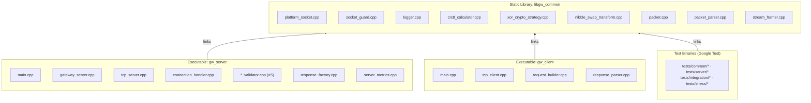

### 14.2 Module Dependency Graph

```mermaid
flowchart BT
    subgraph CommonLayer["Shared Core Library (libgw_common)"]
        PlatformSocket["PlatformSocket\n(Adapter)"]
        SocketGuard["SocketGuard\n(RAII)"]
        Logger["Logger\n(Singleton)"]
        CRC8["Crc8Calculator"]
        Crypto["ICryptoStrategy /\nXorCryptoStrategy\n(Strategy)"]
        Transform["ITransform /\nNibbleSwapTransform"]
        Packet["Packet\n(Value Object)"]
        Parser["PacketParser"]
        Framer["StreamFramer"]
    end

    subgraph ServerBinary["Gateway Server (gw_server)"]
        GWServer["GatewayServer\n(Facade)"]
        TCPServer["TcpServer"]
        ConnHandler["ConnectionHandler\n(Template Method)"]
        ValChain["ValidationChain\n(Chain of Responsibility)"]
        RespFactory["ResponseFactory\n(Factory Method)"]
        Metrics["ServerMetrics\n(Singleton + Observer)"]
    end

    subgraph ClientBinary["Diagnostic Client (gw_client)"]
        ClientMain["ClientApp"]
        TCPClient["TcpClient"]
        ReqBuilder["RequestBuilder"]
        RespParser["ResponseParser"]
    end

    %% Server Internal Dependencies
    GWServer --> TCPServer
    GWServer --> ValChain
    GWServer --> ConnHandler
    TCPServer --> ConnHandler
    ConnHandler --> ValChain
    ConnHandler --> RespFactory
    ConnHandler --> Metrics

    %% Server → Common Dependencies
    ValChain --> CRC8
    ValChain --> Parser
    RespFactory --> CRC8
    RespFactory --> Crypto
    ConnHandler --> Framer
    ConnHandler --> Transform
    ConnHandler --> Crypto
    TCPServer --> PlatformSocket
    GWServer --> Logger

    %% Client Internal Dependencies
    ClientMain --> TCPClient
    TCPClient --> ReqBuilder
    TCPClient --> RespParser

    %% Client → Common Dependencies
    ReqBuilder --> CRC8
    ReqBuilder --> Crypto
    RespParser --> Crypto
    RespParser --> CRC8
    RespParser --> Parser
    TCPClient --> Framer
    TCPClient --> PlatformSocket
    ClientMain --> Logger
```

---

## 15. Phase-Wise Development Plan

### Phase 1 — Foundation & Core Infrastructure

> **Goal:** Establish the CMake build system with C++11 standard, cross-platform socket abstraction (Adapter pattern), RAII wrappers, unified types (`enum class`), and Logger (Singleton).

| Deliverable | Description |
|-------------|-------------|
| CMake build system | Multi-target config with `set(CMAKE_CXX_STANDARD 11)`: `libgw_common`, `gw_server`, `gw_client`, test binaries |
| `gw_types.hpp` | `enum class FailureCode`, `enum class ResponseType`, `constexpr` address constants, size limits |
| `gw_config.hpp` | `constexpr uint16_t DEFAULT_PORT = 13400`, buffer limits, timeouts |
| `PlatformSocket` | Adapter class wrapping Winsock2 / POSIX sockets behind `ISocket` interface |
| `SocketGuard` | RAII wrapper for socket handles — auto-closes on destruction |
| `Logger` | Singleton with `std::mutex`-protected output, `LogLevel` enum, hex dump support |

---

### Phase 2 — Protocol Engine & Frame Serialization

> **Goal:** Implement `Packet` value object, `PacketParser`, `StreamFramer`, Validation Chain (Chain of Responsibility), `ResponseFactory` (Factory Method), and client-side `RequestBuilder` / `ResponseParser`.

| Deliverable | Description |
|-------------|-------------|
| `Packet` class | Immutable value object with `serialize()` and accessors |
| `PacketParser` | Static `parse()` method — big-endian header extraction into `Packet` |
| `StreamFramer` | Static `readFrame()` / `recvExact()` — two-phase TCP framing |
| Validation Chain | `IValidationHandler` interface + `BaseValidator` + 4 concrete validators chained in precedence order |
| `ResponseFactory` | Factory Method creating `PositiveResponse` or `NegativeResponse` byte frames |
| `RequestBuilder` | Client-side frame assembly — valid and intentionally malformed requests |
| `ResponseParser` | Client-side response decoding — type detection, decryption, failure extraction |

---

### Phase 3 — Cryptographic & Transformation Pipeline

> **Goal:** Implement `ICryptoStrategy` / `XorCryptoStrategy` (Strategy pattern), `Crc8Calculator`, and `ITransform` / `NibbleSwapTransform`.

| Deliverable | Description |
|-------------|-------------|
| `ICryptoStrategy` | Abstract interface for pluggable crypto algorithms |
| `XorCryptoStrategy` | Concrete Strategy: in-place XOR with configurable key (`0xAA` or `0x55`) |
| `Crc8Calculator` | CRC-8 class (polynomial `0x07`, init `0x00`) with `compute()` method |
| `ITransform` | Abstract interface for payload transformations |
| `NibbleSwapTransform` | Concrete Transform: in-place nibble swap engine |
| Test vectors | End-to-end trace verification: `0x12 → 0xB8 → 0x12 → 0x21 → 0x74` |

---

### Phase 4 — Networking Layer (TCP Server & TCP Client)

> **Goal:** Implement `TcpServer`, `ConnectionHandler` (Template Method), `TcpClient`, and `GatewayServer` (Facade).

| Deliverable | Description |
|-------------|-------------|
| `TcpServer` | Socket lifecycle: `bind()` → `listen()` → `acceptLoop()` with `SO_REUSEADDR`; spawns `std::thread` per connection |
| `ConnectionHandler` | Template Method `handleClient()`: frame → validate → transform → respond loop; all dependencies injected via constructor |
| `TcpClient` | Client class: `connect()` → `sendFrame()` → `receiveFrame()` |
| `GatewayServer` | Facade: wires `TcpServer`, validators, crypto strategies, transform, metrics; exposes `start()` / `stop()` |
| Client `main.cpp` | Interactive CLI mode + automated test runner mode |
| Server `main.cpp` | Creates `GatewayServer`, calls `start()`, handles signals for graceful shutdown |

---

### Phase 5 — Integration, Logging & Observability

> **Goal:** Wire Server and Client end-to-end, enable structured logging, hex dumps, and `ServerMetrics` (Singleton + Observer).

| Deliverable | Description |
|-------------|-------------|
| End-to-end wiring | Complete client → server → client roundtrip working over TCP |
| Hex dump logging | `Logger::hexDump()` for full RX/TX frame dumps at DEBUG level |
| Transformation trace | Step-by-step logging: decrypt → swap → encrypt → CRC values |
| `ServerMetrics` | Singleton with `std::atomic` counters; Observer notifications from `ConnectionHandler` |
| Metrics dump | `ServerMetrics::dump()` for periodic or on-demand reporting |

---

### Phase 6 — Testing, Hardening & Deployment

> **Goal:** Comprehensive verification with Google Test, integration tests, stress tests, and memory safety analysis.

| Deliverable | Description |
|-------------|-------------|
| Unit tests | `Crc8Calculator`, `XorCryptoStrategy`, `NibbleSwapTransform`, `PacketParser`, `Packet` — all isolated with Google Test |
| Validation tests | Each validator independently + full chain precedence order + all 4 `FailureCode` values |
| Integration tests | `ConnectionHandler` with mock `ISocket`; `ResponseFactory` byte-level verification |
| End-to-end tests | Full TCP roundtrip for every golden test vector |
| Stress tests | 32 concurrent `std::thread` clients × 1,000 requests each; zero-drop verification |
| Memory safety | Full test suite under AddressSanitizer and/or Valgrind — zero leaks, zero overflows |
| README | Build instructions (`cmake`, `make`), execution guide, usage examples |

---

## Document History

| Version | Date | Changes |
|---------|------|---------|
| v1.0 | 2026-11-14 | Initial architecture document — C11, procedural design |
| v2.0 | 2026-11-14 | Major rewrite: C++11, OOP (classes, inheritance, polymorphism, encapsulation), SOLID principles, GoF design patterns (Chain of Responsibility, Strategy, Factory Method, Template Method, Singleton, Adapter, Facade, Observer), RAII, `std::thread`/`std::atomic`, Google Test, `.hpp`/`.cpp` file conventions, restructured directory |
| v3.0 | 2026-11-14 | Added Clean Code principles (Meaningful Names, Small Functions, DRY, YAGNI, CQS, Composition over Inheritance, Fail Fast, Minimal Public Interface), C++ Rule of 0/3/5 classification for all 26 classes, updated all class declarations with explicit special member function annotations, added Rule of Zero/Five comments to every code snippet in Sections 5–6 |

---

> **Related Documents:**
> - [problemStatement.md](problemStatement.md) — Problem statement, protocol specification, key requirements
> - [GW_Requirement_Specification.docx](GW_Requirement_Specification.docx) — Original client requirement document
