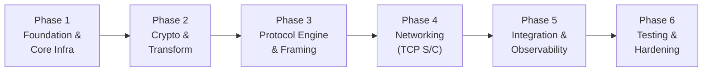
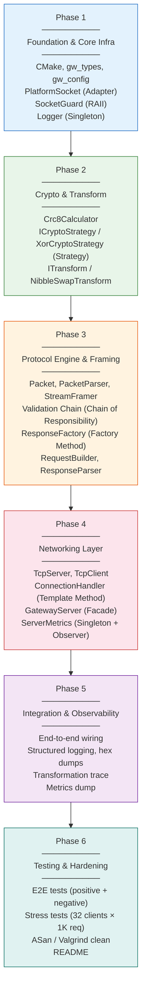

# Gateway (GW) Network Packet Communication — Phase-Wise Implementation Plan

> **Author:** GW Engineering Team
> **Date:** 2026-11-14
> **Status:** Implementation Blueprint
> **Language:** C++11
> **Source Docs:** [architecture.md](architecture.md) · [problemStatement.md](problemStatement.md)

---

## Table of Contents

1. [Plan Overview](#1-plan-overview)
2. [Phase 1 — Foundation & Core Infrastructure](#2-phase-1--foundation--core-infrastructure)
3. [Phase 2 — Cryptographic & Transformation Pipeline](#3-phase-2--cryptographic--transformation-pipeline)
4. [Phase 3 — Protocol Engine & Frame Serialization](#4-phase-3--protocol-engine--frame-serialization)
5. [Phase 4 — Networking Layer (TCP Server & TCP Client)](#5-phase-4--networking-layer-tcp-server--tcp-client)
6. [Phase 5 — Integration, Logging & Observability](#6-phase-5--integration-logging--observability)
7. [Phase 6 — Testing, Hardening & Deployment](#7-phase-6--testing-hardening--deployment)
8. [Phase Dependency Graph](#8-phase-dependency-graph)
9. [Risk Register](#9-risk-register)

---

## 1. Plan Overview

### 1.1 Objective

Deliver a production-grade, multi-threaded Gateway TCP/IP application in C++11 that:
- Listens on **TCP port 13400** for incoming Network Node packets
- Validates, decrypts, nibble-swaps, re-encrypts, and responds to every request (zero-drop)
- Handles **multiple concurrent clients** via thread-per-connection
- Follows **OOP, SOLID principles, Clean Code practices, and GoF design patterns** throughout
- Enforces the **C++ Rule of Zero / Five** for all classes — ensuring correct resource management with no leaks, double-frees, or undefined behavior

### 1.2 Phase Summary

| Phase | Name | Key Deliverables | Design Patterns & Principles Introduced |
|-------|------|------------------|------------------------------|
| 1 | Foundation & Core Infrastructure | CMake, types, platform adapter, RAII, logger | Adapter, Singleton, RAII, **Rule of Five** (SocketGuard, Logger) |
| 2 | Cryptographic & Transformation Pipeline | CRC-8, XOR crypto, nibble swap | Strategy, **Rule of Zero** (Crc8Calculator, XorCryptoStrategy, NibbleSwapTransform), CQS |
| 3 | Protocol Engine & Frame Serialization | Packet, parser, framer, validators, response factory | Chain of Responsibility, Factory Method, **Rule of Zero** (Packet, validators, ResponseFactory), DRY, Fail Fast |
| 4 | Networking Layer | TCP server, connection handler, TCP client, facade | Template Method, Facade, Observer, **Rule of Five** (TcpServer, ConnectionHandler, GatewayServer, TcpClient), Composition over Inheritance, Small Functions |
| 5 | Integration & Observability | End-to-end wiring, logging, metrics | Observer, Singleton, Clean Naming |
| 6 | Testing & Hardening | Unit, integration, stress tests, memory safety | Rule of 0/5 static assertions, Boy Scout Rule |

### 1.3 Conventions

- **Task IDs** follow the format `P<phase>.<task>` (e.g., `P1.1`, `P2.3`)
- **Exit Conditions** are binary pass/fail criteria — every one must be met before proceeding to the next phase
- **Files** use `.hpp` (headers) and `.cpp` (sources) per C++11 convention
- **Tests** use Google Test (gtest) framework
- **Rule of Zero** classes must NOT declare any of the Big Five (destructor, copy ctor, copy assign, move ctor, move assign)
- **Rule of Five** classes must explicitly declare or `= delete` ALL five special member functions
- **Clean Code**: classes are nouns, methods are verbs, functions are small (≤ 20 lines), CQS is enforced (Commands vs. Queries)

---

## 2. Phase 1 — Foundation & Core Infrastructure

> **Goal:** Establish the CMake build system with C++11 standard, cross-platform socket/thread abstraction (Adapter pattern), RAII wrappers, unified protocol types (`enum class`), configuration constants, and the Logger (Singleton).

### 2.1 Prerequisites

- C++11 compatible compiler installed (GCC 4.8+, Clang 3.3+, or MSVC 2015+)
- CMake 3.20+ installed
- Google Test library available (fetched via CMake `FetchContent` or pre-installed)

### 2.2 Task Breakdown

| Task ID | Task | Description | Files Created / Modified | Design Principle |
|---------|------|-------------|--------------------------|------------------|
| P1.1 | **Create project directory structure** | Set up the full directory tree: `include/common/`, `include/server/`, `include/client/`, `src/common/`, `src/server/`, `src/client/`, `tests/common/`, `tests/server/`, `tests/integration/`, `tests/stress/`, `docs/` | All directories | Separation of Concerns |
| P1.2 | **Configure CMake build system** | Root `CMakeLists.txt` with `set(CMAKE_CXX_STANDARD 11)`. Define three targets: `libgw_common` (static library), `gw_server` (executable), `gw_client` (executable), and test binaries. Enable `FetchContent` for Google Test. | `CMakeLists.txt` | — |
| P1.3 | **Define protocol types** | Create `gw_types.hpp` with `enum class FailureCode { None=0x00, SourceAddrInvalid=0x01, TargetAddrInvalid=0x02, IntegrityFailure=0x04, LengthMismatch=0x08 }`, `enum class ResponseType { Positive, Negative }`, valid address constants as `constexpr uint16_t`. | `include/common/gw_types.hpp` | Encapsulation, `enum class` (type safety) |
| P1.4 | **Define configuration constants** | Create `gw_config.hpp` with `constexpr uint16_t DEFAULT_PORT = 13400`, `constexpr size_t GW_HEADER_SIZE = 8`, `constexpr size_t GW_CRC_SIZE = 1`, `constexpr size_t GW_MAX_PAYLOAD_SIZE = 65535`, `constexpr uint8_t GW_KEY_REQUEST = 0xAA`, `constexpr uint8_t GW_KEY_RESPONSE = 0x55`, `constexpr uint8_t GW_CRC8_POLY = 0x07`. | `include/common/gw_config.hpp` | `constexpr` over `#define` |
| P1.5 | **Implement `ISocket` interface** | Define pure-virtual abstract class `ISocket` with `send()`, `recv()`, `close()`, virtual destructor. | `include/common/i_socket.hpp` | Abstraction, Interface Segregation (ISP) |
| P1.6 | **Implement `PlatformSocket` adapter** | Concrete class implementing `ISocket`. Wraps Winsock2 (`#ifdef _WIN32`) or POSIX sockets behind the unified interface. Includes platform init/cleanup static methods. | `include/common/platform_socket.hpp`, `src/common/platform_socket.cpp` | **Adapter Pattern**, Open/Closed (OCP) |
| P1.7 | **Implement `SocketGuard` RAII wrapper** | Wraps a raw socket handle (`gw_socket_t`). Constructor takes ownership; destructor auto-closes. **Rule of Five (move-only):** deleted copy ctor/assignment, user-defined move ctor/assignment that transfers ownership and invalidates the source handle. | `include/common/socket_guard.hpp`, `src/common/socket_guard.cpp` | **RAII Idiom**, **Rule of Five**, Encapsulation |
| P1.8 | **Implement `Logger` singleton** | Singleton class with `static Logger& instance()` via `std::call_once`. Thread-safe output with `std::mutex` + `std::lock_guard`. Methods: `log(LogLevel, module, message)`, `hexDump(LogLevel, module, label, data, length)`. `enum class LogLevel { DEBUG, INFO, WARN, ERROR }`. **Rule of Five (Singleton):** deleted copy AND move operations. Private constructor. | `include/common/logger.hpp`, `src/common/logger.cpp` | **Singleton Pattern**, SRP, **Rule of Five** |
| P1.9 | **Verify build system** | Ensure `cmake --build .` compiles `libgw_common` (with P1.3–P1.8 files), and empty `gw_server` / `gw_client` `main.cpp` stubs link successfully. Run a minimal Google Test binary to verify test infrastructure. | `src/server/main.cpp` (stub), `src/client/main.cpp` (stub), `tests/common/test_stub.cpp` | — |

### 2.3 Exit Conditions

| # | Condition | Verification Method |
|---|-----------|---------------------|
| E1.1 | `cmake --build .` compiles **all three targets** (`libgw_common`, `gw_server`, `gw_client`) with **zero warnings** using `-Wall -Wextra -Werror` (GCC/Clang) or `/W4 /WX` (MSVC) | Build log shows `Build successful` with 0 warnings |
| E1.2 | `gw_server` and `gw_client` stub executables **run and exit cleanly** (exit code 0) | Run both binaries; verify exit code |
| E1.3 | A minimal Google Test binary (`test_stub`) **discovers and runs at least 1 test** and reports `PASSED` | Run `ctest` or `./test_stub`; verify `[  PASSED  ] 1 test` |
| E1.4 | `Logger::instance()` is **callable from two separate threads** without data races or crashes | Manual test: two `std::thread`s calling `Logger::instance().log()` concurrently — no garbled output or segfault |
| E1.5 | `SocketGuard` **auto-closes** a socket handle when going out of scope (verified on both Windows and Linux if cross-platform testing is available) | Unit test: create `SocketGuard` with a valid socket, let it go out of scope, verify socket handle is invalidated |
| E1.5a | `SocketGuard` follows **Rule of Five**: copy operations are `= delete` (compile error on copy), move transfers ownership (source handle becomes `INVALID_SOCKET`), moved-from `SocketGuard` destructor is a no-op | Unit test: `SocketGuard b = std::move(a);` — verify `a` is invalid, `b` owns the handle |
| E1.6 | `enum class FailureCode` values match the problem statement: `0x01`, `0x02`, `0x04`, `0x08` | Static assertion or unit test: `static_assert(static_cast<uint8_t>(FailureCode::SourceAddrInvalid) == 0x01, "...")` |
| E1.7 | All `constexpr` config values match the problem statement (`DEFAULT_PORT == 13400`, `GW_KEY_REQUEST == 0xAA`, `GW_KEY_RESPONSE == 0x55`, `GW_CRC8_POLY == 0x07`) | Static assertions in `gw_config.hpp` |

---

## 3. Phase 2 — Cryptographic & Transformation Pipeline

> **Goal:** Implement the three core data-processing classes — `Crc8Calculator`, `ICryptoStrategy` / `XorCryptoStrategy` (Strategy pattern), and `ITransform` / `NibbleSwapTransform` — with full unit test coverage.

### 3.1 Prerequisites

- Phase 1 exit conditions E1.1–E1.7 all met
- `libgw_common` builds and links successfully

### 3.2 Task Breakdown

| Task ID | Task | Description | Files Created / Modified | Design Principle |
|---------|------|-------------|--------------------------|------------------|
| P2.1 | **Implement `Crc8Calculator`** | Class with constructor `Crc8Calculator(uint8_t polynomial = 0x07, uint8_t initialValue = 0x00)`. Methods: `uint8_t compute(const uint8_t* data, size_t length) const` and `uint8_t compute(const std::vector<uint8_t>& data) const`. Bit-by-bit CRC-8 algorithm. **Rule of Zero** — only `const` scalar members; no custom destructor/copy/move needed. `compute()` is a pure query function (CQS). | `include/common/crc8_calculator.hpp`, `src/common/crc8_calculator.cpp` | SRP, Encapsulation, **Rule of Zero**, CQS |
| P2.2 | **Unit test `Crc8Calculator`** | Google Test fixture: verify CRC-8 for known test vectors — empty input, single byte `0x00`, single byte `0xB8`, multi-byte sequence, all-zeros, all-ones. Verify that `compute([0xB8]) == 0x21` (standard CRC-8 with polynomial 0x07, init 0x00). | `tests/common/test_crc8_calculator.cpp` | — |
| P2.3 | **Define `ICryptoStrategy` interface** | Pure-virtual abstract class: `virtual void process(uint8_t* data, size_t length) const = 0` and `virtual uint8_t getKey() const = 0`. Virtual destructor. | `include/common/i_crypto_strategy.hpp` | Abstraction, ISP, DIP |
| P2.4 | **Implement `XorCryptoStrategy`** | Concrete Strategy: constructor takes `uint8_t key`. `process()` XORs every byte in-place with the key (Command — modifies buffer). `getKey()` returns the stored key (Query — no side effects). **Rule of Zero** — only `const uint8_t key_` member. | `include/common/xor_crypto_strategy.hpp`, `src/common/xor_crypto_strategy.cpp` | **Strategy Pattern**, OCP, LSP, **Rule of Zero**, CQS |
| P2.5 | **Unit test `XorCryptoStrategy`** | Test with key `0xAA`: `process([0x12]) → [0xB8]`, double-apply restores original. Test with key `0x55`: `process([0x21]) → [0x74]`. Test with empty data (no crash). Test with multi-byte data. | `tests/common/test_xor_crypto_strategy.cpp` | — |
| P2.6 | **Define `ITransform` interface** | Pure-virtual abstract class: `virtual void apply(uint8_t* data, size_t length) const = 0`. Virtual destructor. | `include/common/i_transform.hpp` | Abstraction, ISP |
| P2.7 | **Implement `NibbleSwapTransform`** | Concrete class: `apply()` swaps high/low nibbles of each byte: `data[i] = ((data[i] & 0x0F) << 4) | ((data[i] & 0xF0) >> 4)`. **Rule of Zero** — stateless class with no data members. `apply()` is a Command (in-place transform, no return value). | `include/common/nibble_swap_transform.hpp`, `src/common/nibble_swap_transform.cpp` | SRP, LSP, **Rule of Zero**, CQS |
| P2.8 | **Unit test `NibbleSwapTransform`** | Test: `0x12 → 0x21`, `0xAB → 0xBA`, `0x00 → 0x00`, `0xFF → 0xFF`, `0xF0 → 0x0F`. Multi-byte: `[0x12, 0x34, 0xAB] → [0x21, 0x43, 0xBA]`. Double-apply restores original. | `tests/common/test_nibble_swap_transform.cpp` | — |
| P2.9 | **End-to-end transformation trace test** | Integration-style unit test: chain all three operations in sequence — `XorCryptoStrategy(0xAA).process()` → `NibbleSwapTransform.apply()` → `XorCryptoStrategy(0x55).process()` → `Crc8Calculator.compute()`. Verify: `input [0x12] → encrypted [0xB8] → decrypted [0x12] → swapped [0x21] → re-encrypted [0x74]`. | `tests/common/test_transformation_pipeline.cpp` | Strategy, DIP |

### 3.3 Exit Conditions

| # | Condition | Verification Method |
|---|-----------|---------------------|
| E2.1 | `Crc8Calculator::compute([0xB8])` returns exactly `0x21` (standard CRC-8 with polynomial 0x07, init 0x00) | Google Test assertion |
| E2.2 | `XorCryptoStrategy(0xAA).process()` on `[0x12]` produces `[0xB8]`; applying it again restores `[0x12]` | Google Test assertion |
| E2.3 | `XorCryptoStrategy(0x55).process()` on `[0x21]` produces `[0x74]` | Google Test assertion |
| E2.4 | `NibbleSwapTransform::apply()` on `[0x12, 0x34, 0xAB]` produces `[0x21, 0x43, 0xBA]` | Google Test assertion |
| E2.5 | Double-applying `NibbleSwapTransform` restores the original data for all test inputs | Google Test assertion |
| E2.6 | Full pipeline trace: `[0x12] → XOR(0xAA) → [0xB8] → XOR(0xAA) → [0x12] → nibble_swap → [0x21] → XOR(0x55) → [0x74] → CRC-8 → [0x4B]` — all intermediate values verified | Google Test assertion in `test_transformation_pipeline.cpp` |
| E2.7 | All Phase 2 tests pass: `ctest` reports **0 failures** for `test_crc8_calculator`, `test_xor_crypto_strategy`, `test_nibble_swap_transform`, `test_transformation_pipeline` | `ctest` output shows all PASSED |
| E2.8 | `ICryptoStrategy` and `ITransform` are **pure-virtual** — attempting to instantiate them directly causes a compile error | Verified by code review; no concrete methods in interfaces |

---

## 4. Phase 3 — Protocol Engine & Frame Serialization

> **Goal:** Implement `Packet` value object, `PacketParser`, `StreamFramer`, the 4-stage Validation Chain (Chain of Responsibility), `ResponseFactory` (Factory Method), and client-side `RequestBuilder` / `ResponseParser`.

### 4.1 Prerequisites

- Phase 2 exit conditions E2.1–E2.8 all met
- `Crc8Calculator`, `XorCryptoStrategy`, `NibbleSwapTransform` all implemented and tested

### 4.2 Task Breakdown

| Task ID | Task | Description | Files Created / Modified | Design Principle |
|---------|------|-------------|--------------------------|------------------|
| P3.1 | **Implement `Packet` value object** | Immutable class. Constructor: `Packet(uint16_t sourceAddr, uint16_t targetAddr, uint32_t length, std::vector<uint8_t> payload, uint8_t crc)`. Accessors: `sourceAddr()`, `targetAddr()`, `length()`, `payloadLen()` (= length - 1), `payload()`, `crc()`. Method: `serialize()` returns `std::vector<uint8_t>` with full frame bytes (big-endian header + payload + CRC). **Rule of Zero** — `std::vector` member self-manages; compiler-generated copy/move/destructor are correct. Meaningful naming: all accessors named after the field they return. | `include/common/packet.hpp`, `src/common/packet.cpp` | Encapsulation, Value Object, **Rule of Zero**, Clean Naming |
| P3.2 | **Unit test `Packet`** | Test construction, accessor values, `payloadLen() == length() - 1`, `serialize()` produces correct big-endian byte sequence for known SA/TA/Length/Payload/CRC values. | `tests/common/test_packet.cpp` | — |
| P3.3 | **Implement `PacketParser`** | Static class with `static Packet parse(const std::vector<uint8_t>& frameData)`. Extracts SA (bytes 0–1), TA (bytes 2–3), Length (bytes 4–7) in big-endian, payload (bytes 8 to 8+length-2), CRC (last byte). Throws `std::invalid_argument` if buffer too small. | `include/common/packet_parser.hpp`, `src/common/packet_parser.cpp` | SRP |
| P3.4 | **Unit test `PacketParser`** | Parse known byte sequence `[0x0E, 0x80, 0x31, 0x08, 0x00, 0x00, 0x00, 0x02, 0xB8, 0x21]` → verify `SA==0x0E80`, `TA==0x3108`, `Length==2`, `payload==[0xB8]`, `CRC==0x21`. Test with minimum frame (9 bytes) and multi-byte payload. Test exception on undersized buffer. | `tests/common/test_packet_parser.cpp` | — |
| P3.5 | **Implement `StreamFramer`** | Static class with: `static ssize_t recvExact(ISocket& socket, uint8_t* buffer, size_t count)` — loops on `recv()` until exactly `count` bytes are read or error. `static std::vector<uint8_t> readFrame(ISocket& socket)` — reads 8-byte header, extracts Length (big-endian uint32), reads exactly Length more bytes, returns complete frame. | `include/common/stream_framer.hpp`, `src/common/stream_framer.cpp` | SRP, DIP (depends on `ISocket`) |
| P3.6 | **Define `IValidationHandler` interface** | Pure-virtual: `virtual IValidationHandler* setNext(IValidationHandler* handler) = 0` and `virtual FailureCode validate(const Packet& packet) const = 0`. Virtual destructor. | `include/server/i_validation_handler.hpp` | Abstraction, ISP |
| P3.7 | **Implement `BaseValidator`** | Abstract class implementing `IValidationHandler`. Holds `IValidationHandler* next_` (non-owning pointer — chain does not own its successors). `setNext()` stores and returns next. `validate()` calls `doValidate()` (pure-virtual hook); if result is `FailureCode::None` and `next_` exists, delegates to `next_->validate()`. **Rule of Zero** — non-owning pointer needs no custom destructor/copy/move. DRY: common chaining logic lives here once, not repeated in each validator. | `include/server/base_validator.hpp`, `src/server/base_validator.cpp` | **Chain of Responsibility**, OCP, **Rule of Zero**, DRY |
| P3.8 | **Implement `LengthValidator`** | Extends `BaseValidator`. `doValidate()`: checks `packet.length() >= 2` (at least 1 payload byte + 1 CRC byte) and total frame size consistency. Returns `FailureCode::LengthMismatch` on failure. **Rule of Zero** — inherits `BaseValidator`; no added resources. Small function: `doValidate()` is a single-responsibility validation check (≤ 10 lines). | `include/server/length_validator.hpp`, `src/server/length_validator.cpp` | SRP, LSP, **Rule of Zero** |
| P3.9 | **Implement `SourceAddressValidator`** | Extends `BaseValidator`. `doValidate()`: checks `packet.sourceAddr()` is `0x0E80` or `0xE008`. Returns `FailureCode::SourceAddrInvalid` on failure. **Rule of Zero** — no data members beyond inherited `next_`. Meaningful name: class name describes exactly what it validates. | `include/server/source_address_validator.hpp`, `src/server/source_address_validator.cpp` | SRP, LSP, **Rule of Zero** |
| P3.10 | **Implement `TargetAddressValidator`** | Extends `BaseValidator`. `doValidate()`: checks `packet.targetAddr()` is `0x3108` or `0x1380`. Returns `FailureCode::TargetAddrInvalid` on failure. **Rule of Zero** — no data members beyond inherited `next_`. | `include/server/target_address_validator.hpp`, `src/server/target_address_validator.cpp` | SRP, LSP, **Rule of Zero** |
| P3.11 | **Implement `CrcValidator`** | Extends `BaseValidator`. Holds `const Crc8Calculator& crc_` (Dependency Injection — non-owning reference). `doValidate()`: computes CRC-8 over encrypted payload, compares with `packet.crc()`. Returns `FailureCode::IntegrityFailure` on mismatch. **Rule of Zero** — stores only a `const` reference (non-owning); no custom destructor/copy/move needed. | `include/server/crc_validator.hpp`, `src/server/crc_validator.cpp` | SRP, DIP, LSP, **Rule of Zero** |
| P3.12 | **Unit test each validator independently** | One test file per validator: valid packet → `FailureCode::None`; invalid packet → correct failure code. Test boundary cases (exactly valid SA, exactly invalid SA, etc.). | `tests/server/test_length_validator.cpp`, `tests/server/test_source_address_validator.cpp`, `tests/server/test_target_address_validator.cpp`, `tests/server/test_crc_validator.cpp` | — |
| P3.13 | **Unit test full validation chain** | Assemble chain: `LengthValidator → SourceAddressValidator → TargetAddressValidator → CrcValidator`. Test precedence: when multiple failures exist, the chain returns the **first** one (e.g., bad SA + bad CRC → returns `0x01`, not `0x04`). Test all 4 failure codes individually. Test fully valid packet → `FailureCode::None`. | `tests/server/test_validation_chain.cpp` | Chain of Responsibility |
| P3.14 | **Implement `ResponseFactory`** | Class with constructor: `ResponseFactory(const ICryptoStrategy& responseCrypto, const Crc8Calculator& crc)`. Factory Method: `std::vector<uint8_t> create(const Packet& request, FailureCode code, const std::vector<uint8_t>& transformedPayload = {})`. If `code == None`, builds positive response (swap SA/TA, encrypt payload with response crypto, compute CRC, pack frame). If `code != None`, builds negative response (swap SA/TA, unencrypted failure code byte, CRC over failure code, pack 10-byte frame). **Rule of Zero** — stores only `const` references (non-owning). | `include/server/response_factory.hpp`, `src/server/response_factory.cpp` | **Factory Method**, SRP, DIP, **Rule of Zero** |
| P3.15 | **Unit test `ResponseFactory`** | Test positive response: verify SA/TA swapped, payload encrypted with `0x55`, CRC correct, total frame length correct. Test negative response for each failure code: verify 10-byte frame, unencrypted failure code, correct CRC over failure code. | `tests/server/test_response_factory.cpp` | — |
| P3.16 | **Implement `RequestBuilder` (client)** | Class with methods: `std::vector<uint8_t> build(uint16_t sa, uint16_t ta, const std::vector<uint8_t>& rawPayload)` — encrypts with `XorCryptoStrategy(0xAA)`, computes CRC-8, packs big-endian header. `std::vector<uint8_t> buildInvalid(uint16_t sa, uint16_t ta, const std::vector<uint8_t>& payload, bool corruptCrc, bool corruptLength)` — for negative-response conformance testing. **Rule of Zero** — stores only `const` references (non-owning). `build()` and `buildInvalid()` are meaningful verb-names (Clean Code). | `include/client/request_builder.hpp`, `src/client/request_builder.cpp` | SRP, DIP, **Rule of Zero** |
| P3.17 | **Implement `ResponseParser` (client)** | Class with method: `ClientResponse parse(const std::vector<uint8_t>& frameData)`. Returns struct `ClientResponse { ResponseType type; uint16_t sourceAddr; uint16_t targetAddr; FailureCode failureCode; std::vector<uint8_t> decryptedPayload; }`. Detects positive vs. negative by payload length. Decrypts positive payload with `XorCryptoStrategy(0x55)`. **Rule of Zero** — stores only `const` references. `ClientResponse` struct is also Rule of Zero (all self-managing members). | `include/client/response_parser.hpp`, `src/client/response_parser.cpp` | SRP, **Rule of Zero** |

### 4.3 Exit Conditions

| # | Condition | Verification Method |
|---|-----------|---------------------|
| E3.1 | `Packet::serialize()` for `SA=0x0E80, TA=0x3108, payload=[0xB8], CRC=0x21` produces exactly `[0x0E, 0x80, 0x31, 0x08, 0x00, 0x00, 0x00, 0x02, 0xB8, 0x21]` | Google Test assertion |
| E3.2 | `PacketParser::parse()` round-trips: `parse(packet.serialize()) == packet` for all test packets | Google Test assertion |
| E3.3 | `LengthValidator` returns `FailureCode::LengthMismatch` for inconsistent length; `FailureCode::None` for valid | Google Test assertions |
| E3.4 | `SourceAddressValidator` returns `FailureCode::SourceAddrInvalid` for SA ∉ {`0x0E80`, `0xE008`}; `FailureCode::None` for valid | Google Test assertions |
| E3.5 | `TargetAddressValidator` returns `FailureCode::TargetAddrInvalid` for TA ∉ {`0x3108`, `0x1380`}; `FailureCode::None` for valid | Google Test assertions |
| E3.6 | `CrcValidator` returns `FailureCode::IntegrityFailure` for CRC mismatch; `FailureCode::None` for valid | Google Test assertions |
| E3.7 | **Validation chain precedence verified:** packet with both invalid SA and bad CRC → chain returns `FailureCode::SourceAddrInvalid` (not `IntegrityFailure`) | Google Test assertion in `test_validation_chain.cpp` |
| E3.8 | `ResponseFactory` positive response for `payload=[0x21]` produces frame with encrypted byte `0x74` (= `0x21 XOR 0x55`), correct CRC (`0x4B`), and swapped SA/TA | Google Test byte-level assertion |
| E3.9 | `ResponseFactory` negative response for `FailureCode::TargetAddrInvalid` produces exactly 10-byte frame with unencrypted `0x02` failure code | Google Test byte-level assertion |
| E3.10 | `RequestBuilder::build()` for raw `[0x12]` produces frame matching `[0x0E, 0x80, 0x31, 0x08, 0x00, 0x00, 0x00, 0x02, 0xB8, 0x21]` | Google Test assertion |
| E3.11 | `ResponseParser::parse()` correctly identifies positive vs. negative responses and extracts `decryptedPayload` or `failureCode` | Google Test assertions |
| E3.12 | All Phase 3 tests pass: `ctest` reports **0 failures** across all `test_*` binaries | `ctest` output |
| E3.13 | All **Rule of Zero** classes (`Packet`, `PacketParser`, `BaseValidator`, all concrete validators, `ResponseFactory`, `RequestBuilder`, `ResponseParser`) compile without any user-declared destructor, copy constructor, copy assignment, move constructor, or move assignment — verified by code review | Code review: `grep -rn "~Packet\|Packet(const\|operator=" include/` returns no hits for these classes |

---

## 5. Phase 4 — Networking Layer (TCP Server & TCP Client)

> **Goal:** Implement `TcpServer`, `ConnectionHandler` (Template Method), `TcpClient`, and `GatewayServer` (Facade). Achieve a working TCP connection with request/response exchange.

### 5.1 Prerequisites

- Phase 3 exit conditions E3.1–E3.12 all met
- All protocol, validation, crypto, and frame construction classes tested and passing

### 5.2 Task Breakdown

| Task ID | Task | Description | Files Created / Modified | Design Principle |
|---------|------|-------------|--------------------------|------------------|
| P4.1 | **Implement `TcpServer`** | Class managing server socket lifecycle. Methods: `void bind(uint16_t port)` — creates socket, `SO_REUSEADDR`, binds to `0.0.0.0:port`. `void listen(int backlog = 32)`. `void acceptLoop(ConnectionHandlerFactory)` — infinite loop accepting connections, spawns `std::thread` per client passing the accepted `SocketGuard` to a `ConnectionHandler`. `void stop()` — sets `std::atomic<bool> running_` to false, closes listener socket. **Rule of Five (non-movable):** custom destructor calls `stop()` and joins threads; copy AND move `= delete` (owns listener socket + thread vector + atomic state). | `include/server/tcp_server.hpp`, `src/server/tcp_server.cpp` | SRP, RAII, **Rule of Five** |
| P4.2 | **Implement `ConnectionHandler`** | Class implementing the **Template Method** pattern. Constructor receives all dependencies via injection (Composition over Inheritance): `IValidationHandler&`, `ICryptoStrategy& requestCrypto`, `ICryptoStrategy& responseCrypto`, `ITransform&`, `ResponseFactory&`, `ServerMetrics&`. Method `void handleClient(SocketGuard socket)`: while loop reading frames → parse → validate → (transform + build positive) or (build negative) → send. Each step is a **Small Function** (≤ 20 lines). Catches all exceptions per-connection so one client crash never affects others. **Rule of Five (move-only):** owns `std::unique_ptr<ISocket>`; copy `= delete`, move `= default`. | `include/server/connection_handler.hpp`, `src/server/connection_handler.cpp` | **Template Method**, DIP, SRP, **Rule of Five**, Composition over Inheritance, Small Functions |
| P4.3 | **Implement `ServerMetrics`** | Singleton class. All counters are `std::atomic<uint64_t>`. Observer methods (Commands): `onRequestReceived()`, `onPositiveResponse()`, `onNegativeResponse(FailureCode)`, `onClientConnected()`, `onClientDisconnected()`. Accessors (Queries): `totalRequests() const`, `positiveResponses() const`, etc. Thread-safe `instance()` via `std::call_once`. `dump()` logs current counters. **Rule of Five (Singleton):** private constructor; copy AND move `= delete`. CQS: observer methods are Commands, accessors are Queries. | `include/server/server_metrics.hpp`, `src/server/server_metrics.cpp` | **Singleton**, **Observer**, SRP, **Rule of Five**, CQS |
| P4.4 | **Implement `GatewayServer` facade** | Facade class that creates and wires: `Crc8Calculator`, `XorCryptoStrategy(0xAA)`, `XorCryptoStrategy(0x55)`, `NibbleSwapTransform`, all 4 validators (chained via `std::unique_ptr`), `ResponseFactory`, `TcpServer`. Methods: `void start()` — inits platform, binds, listens, enters accept loop. `void stop()`. Constructor takes `uint16_t port = 13400`. **Rule of Five (non-movable):** custom destructor calls `stop()`; copy AND move `= delete` (owns threads + unique_ptrs + atomic state). | `include/server/gateway_server.hpp`, `src/server/gateway_server.cpp` | **Facade Pattern**, DIP, **Rule of Five** |
| P4.5 | **Implement server `main.cpp`** | Entry point: parses optional `--port` CLI argument, creates `GatewayServer`, installs signal handler for `SIGINT`/`SIGTERM` → calls `stop()`, calls `start()`. | `src/server/main.cpp` | — |
| P4.6 | **Implement `TcpClient`** | Class with methods: `void connect(const std::string& ip, uint16_t port)` — creates socket, connects. `void sendFrame(const std::vector<uint8_t>& frame)`. `std::vector<uint8_t> receiveFrame()` — uses `StreamFramer::readFrame()`. `void disconnect()` — closes socket. RAII: destructor calls `disconnect()`. **Rule of Five (move-only):** custom destructor disconnects; copy `= delete`; move transfers socket ownership (source invalidated). | `include/client/tcp_client.hpp`, `src/client/tcp_client.cpp` | SRP, RAII, DIP, **Rule of Five** |
| P4.7 | **Implement client `main.cpp`** | Entry point with two modes: **Interactive mode** — prompts for hex payload bytes, builds request, sends, receives response, displays decoded result. **Automated test mode** (`--test` flag) — runs predefined test scenarios (valid request, invalid SA, invalid TA, bad CRC, length mismatch), reports pass/fail per scenario. | `src/client/main.cpp` | — |
| P4.8 | **Manual smoke test** | Start `gw_server` in one terminal. Run `gw_client --test` in another. Visually verify positive and negative responses for basic scenarios. | — | — |

### 5.3 Exit Conditions

| # | Condition | Verification Method |
|---|-----------|---------------------|
| E4.1 | `gw_server` starts, binds to port **13400**, and logs `"Server listening on 0.0.0.0:13400"` | Run `gw_server`; observe log output |
| E4.2 | `gw_client` connects to `gw_server`, sends a **valid single-byte request** (`payload=[0x12]`), and receives a **positive response** with decrypted payload `[0x21]` | Run client in test mode; verify output |
| E4.3 | `gw_client` sends a request with **invalid Source Address** (`0xFFFF`) and receives a **negative response** with `FailureCode::SourceAddrInvalid` (`0x01`) | Client test mode output |
| E4.4 | `gw_client` sends a request with **invalid Target Address** (`0x9999`) and receives a **negative response** with `FailureCode::TargetAddrInvalid` (`0x02`) | Client test mode output |
| E4.5 | `gw_client` sends a request with **corrupted CRC** and receives a **negative response** with `FailureCode::IntegrityFailure` (`0x04`) | Client test mode output |
| E4.6 | `gw_client` sends a request with **mismatched Length field** and receives a **negative response** with `FailureCode::LengthMismatch` (`0x08`) | Client test mode output |
| E4.7 | **Two concurrent clients** can connect and exchange requests/responses simultaneously — both receive correct responses | Launch 2 client instances in parallel; verify both get responses |
| E4.8 | Server **does not crash** when a client disconnects abruptly (TCP RST) — RAII cleanup works, server continues accepting | Kill a client mid-connection; verify server keeps running |
| E4.9 | `gw_server` shuts down cleanly on `SIGINT` / `Ctrl+C` — all threads joined, sockets closed, no resource leaks | Send SIGINT; verify clean exit log and exit code 0 |
| E4.10 | `ServerMetrics::instance().dump()` shows **non-zero counters** after processing requests (totalRequests > 0, positiveResponses > 0, at least one negative counter > 0) | Observe metrics dump in server logs after test run |
| E4.11 | **Rule of Five verified** for `TcpServer`, `GatewayServer`, `ConnectionHandler`, `TcpClient`: copy operations cause compile error; `TcpServer`/`GatewayServer` move operations cause compile error; `ConnectionHandler`/`TcpClient` move operations compile and transfer ownership correctly | Static assertion tests: `static_assert(!std::is_copy_constructible<TcpServer>::value, "...")` etc. |
| E4.12 | **Rule of Five verified** for singletons: `Logger` and `ServerMetrics` copy AND move operations all cause compile errors | Static assertion tests: `static_assert(!std::is_move_constructible<Logger>::value, "...")` |

---

## 6. Phase 5 — Integration, Logging & Observability

> **Goal:** Wire all subsystems end-to-end, add detailed structured logging at every pipeline stage, hex dump support, and complete metrics observability.

### 6.1 Prerequisites

- Phase 4 exit conditions E4.1–E4.10 all met
- Both `gw_server` and `gw_client` operational with basic request/response exchange

### 6.2 Task Breakdown

| Task ID | Task | Description | Files Created / Modified | Design Principle |
|---------|------|-------------|--------------------------|------------------|
| P5.1 | **Add frame-level hex dump logging** | In `ConnectionHandler::handleClient()`: after `StreamFramer::readFrame()`, call `Logger::hexDump(LogLevel::DEBUG, "FRAMER", "RX", data, length)`. Before `socket.send()`, call `Logger::hexDump(LogLevel::DEBUG, "FRAMER", "TX", data, length)`. | `src/server/connection_handler.cpp` | Observer, SRP |
| P5.2 | **Add validation result logging** | After `validationChain_.validate()`: log `INFO` on success with SA/TA values; log `WARN` on failure with specific `FailureCode` name. | `src/server/connection_handler.cpp` | — |
| P5.3 | **Add transformation trace logging** | Log `DEBUG` after each step: `"Decrypt: [XX] → Swap: [YY] → Encrypt: [ZZ] → CRC: [WW]"` showing hex values at each stage. | `src/server/connection_handler.cpp` | — |
| P5.4 | **Add connection lifecycle logging** | Log `INFO` on client connect (with remote IP:port) and disconnect. Log `ERROR` on exceptions caught in `handleClient()`. | `src/server/connection_handler.cpp`, `src/server/tcp_server.cpp` | — |
| P5.5 | **Add client-side logging** | Log `INFO` on connect/disconnect. Log `DEBUG` hex dumps of sent requests and received responses. Log parsed response type and payload/failure code. | `src/client/tcp_client.cpp`, `src/client/main.cpp` | — |
| P5.6 | **Implement `ServerMetrics::dump()`** | Formats all counters into a multi-line log entry: total requests, positive responses, each negative code count, active connections, total connections. Called on server shutdown and optionally on a timer or SIGUSR1 signal. | `src/server/server_metrics.cpp` | Singleton, Observer |
| P5.7 | **Verify log output format** | Run full test scenario and verify log lines match the specified format: `[YYYY-MM-DD HH:MM:SS.mmm] [LEVEL] [MODULE] message`. | — | — |
| P5.8 | **Add `--log-level` CLI argument** | Allow `gw_server --log-level DEBUG` and `gw_client --log-level DEBUG` to control verbosity. Default: `INFO`. | `src/server/main.cpp`, `src/client/main.cpp` | — |

### 6.3 Exit Conditions

| # | Condition | Verification Method |
|---|-----------|---------------------|
| E5.1 | Running `gw_server --log-level DEBUG` and sending one valid request produces **all 6 log line categories**: connection event, RX hex dump, validation result, transformation trace, TX hex dump, response delivery confirmation | Inspect server stdout |
| E5.2 | Log output for the test vector (`payload [0x12]`) shows exactly: `Decrypt: [12] → Swap: [21] → Encrypt: [74] → CRC: [4B]` | Inspect `[TRANS]` log line |
| E5.3 | RX hex dump shows `0E 80 31 08 00 00 00 02 B8 21` and TX hex dump shows `31 08 0E 80 00 00 00 02 74 4B` for the test vector | Inspect `[FRAMER]` log lines |
| E5.4 | Validation failure log includes the **specific failure code name** (e.g., `"Validation failed: SourceAddrInvalid (0x01)"`) | Send invalid SA request; inspect log |
| E5.5 | `ServerMetrics::dump()` on shutdown shows **accurate counters** matching the number of requests sent during the test | Inspect metrics dump in shutdown log |
| E5.6 | `--log-level INFO` suppresses all `[DEBUG]` lines; `--log-level ERROR` suppresses `[DEBUG]`, `[INFO]`, and `[WARN]` | Run with each level; verify filtering |
| E5.7 | All log output is **thread-safe**: no garbled lines when 4+ concurrent clients are sending requests | Run 4 clients concurrently with DEBUG logging; inspect output for corruption |

---

## 7. Phase 6 — Testing, Hardening & Deployment

> **Goal:** Achieve comprehensive test coverage with Google Test — unit tests, integration tests (full TCP roundtrip), stress/concurrency tests (zero-drop verification), and memory safety validation. Produce the final `README.md`.

### 7.1 Prerequisites

- Phase 5 exit conditions E5.1–E5.7 all met
- Fully operational `gw_server` and `gw_client` with logging and metrics

### 7.2 Task Breakdown

| Task ID | Task | Description | Files Created / Modified |
|---------|------|-------------|--------------------------|
| P6.1 | **E2E test: positive response — single byte** | Google Test: start `gw_server` in-process (or via fixture), connect `TcpClient`, send `RequestBuilder::build(0x0E80, 0x3108, [0x12])`, receive and parse response, assert `type == Positive`, `decryptedPayload == [0x21]`. | `tests/integration/test_e2e_positive.cpp` |
| P6.2 | **E2E test: positive response — multi byte** | Same as P6.1 with `payload = [0x12, 0x34, 0xAB]`, expected `[0x21, 0x43, 0xBA]`. | `tests/integration/test_e2e_positive.cpp` |
| P6.3 | **E2E test: positive response — all address pairs** | Test all valid combinations: `(SA=0x0E80, TA=0x3108)`, `(SA=0x0E80, TA=0x1380)`, `(SA=0xE008, TA=0x3108)`, `(SA=0xE008, TA=0x1380)`. Verify SA/TA correctly swapped in each response. | `tests/integration/test_e2e_address_pairs.cpp` |
| P6.4 | **E2E test: positive response — edge payloads** | Test `[0x00]` → `[0x00]`, `[0xFF]` → `[0xFF]`, `[0xF0]` → `[0x0F]`, `[0x0F]` → `[0xF0]`. | `tests/integration/test_e2e_positive.cpp` |
| P6.5 | **E2E test: negative response — invalid SA** | Send `SA=0xFFFF`, assert negative response with `FailureCode::SourceAddrInvalid` (`0x01`). | `tests/integration/test_e2e_negative.cpp` |
| P6.6 | **E2E test: negative response — invalid TA** | Send `TA=0x9999`, assert negative response with `FailureCode::TargetAddrInvalid` (`0x02`). | `tests/integration/test_e2e_negative.cpp` |
| P6.7 | **E2E test: negative response — bad CRC** | Send valid SA/TA but corrupt CRC byte, assert `FailureCode::IntegrityFailure` (`0x04`). | `tests/integration/test_e2e_negative.cpp` |
| P6.8 | **E2E test: negative response — length mismatch** | Send valid SA/TA but Length field ≠ actual body size, assert `FailureCode::LengthMismatch` (`0x08`). | `tests/integration/test_e2e_negative.cpp` |
| P6.9 | **E2E test: validation precedence** | Send packet with BOTH invalid SA and bad CRC. Assert response is `0x01` (not `0x04`) — SA is checked before CRC. | `tests/integration/test_e2e_negative.cpp` |
| P6.10 | **E2E test: multiple sequential requests on same connection** | Single client sends 10 requests in sequence on one TCP connection. Verify all 10 responses received and correct. | `tests/integration/test_e2e_positive.cpp` |
| P6.11 | **Stress test: 32 concurrent clients** | Spawn 32 `std::thread`s, each creating a `TcpClient`, sending 1,000 requests (mix of valid and invalid). Collect all responses. Assert total responses == total requests (zero-drop). Assert all positive responses have correct transformed payload. Assert all negative responses have correct failure codes. | `tests/stress/test_concurrent_clients.cpp` |
| P6.12 | **Stress test: zero-drop verification** | Variant of P6.11 focused on counting: `totalSent == totalReceived` for every client thread. No thread reports a send/receive mismatch. | `tests/stress/test_zero_drop.cpp` |
| P6.13 | **ConnectionHandler mock-socket test** | Unit test `ConnectionHandler` with a mock `ISocket` (in-memory buffer instead of real TCP). Inject known request bytes, capture response bytes, verify pipeline logic without network. | `tests/server/test_connection_handler.cpp` |
| P6.14 | **Memory safety: ASan run** | Compile entire test suite with `-fsanitize=address` (GCC/Clang). Run all tests. Assert zero ASan errors (leaks, overflows, use-after-free). | CMake option: `-DSANITIZE_ADDRESS=ON` |
| P6.15 | **Memory safety: Valgrind run** | Run full test suite under `valgrind --leak-check=full --error-exitcode=1`. Assert zero memory leaks and zero errors. (Linux only) | `valgrind` command |
| P6.16 | **Write `README.md`** | Document: prerequisites, build instructions (`cmake -B build && cmake --build build`), running server/client, test execution (`ctest --test-dir build`), project structure overview, protocol summary. | `README.md` |

### 7.3 Exit Conditions

| # | Condition | Verification Method |
|---|-----------|---------------------|
| E6.1 | **All unit tests pass:** `ctest` reports 0 failures for `test_crc8_calculator`, `test_xor_crypto_strategy`, `test_nibble_swap_transform`, `test_packet`, `test_packet_parser`, all validator tests, `test_validation_chain`, `test_response_factory`, `test_connection_handler` | `ctest` output: `100% tests passed` |
| E6.2 | **All integration tests pass:** positive response flows for single-byte, multi-byte, edge payloads, and all 4 address pair permutations return correct transformed payloads | `ctest` output for `test_e2e_*` |
| E6.3 | **All negative response E2E tests pass:** each failure code (`0x01`, `0x02`, `0x04`, `0x08`) returned for the correct error condition | `ctest` output for `test_e2e_negative` |
| E6.4 | **Validation precedence confirmed E2E:** dual-failure packet (bad SA + bad CRC) returns `0x01` (not `0x04`) | `ctest` output for precedence test case |
| E6.5 | **Zero-drop under 32 concurrent clients:** `totalSent == totalReceived` for each of the 32 client threads (32,000 total requests → 32,000 total responses) | `ctest` output for `test_concurrent_clients` and `test_zero_drop` |
| E6.6 | **No request skipped:** every request (valid or invalid) receives exactly one response — verified by the stress test counters | Stress test assertions |
| E6.7 | **AddressSanitizer clean:** full test suite compiled with `-fsanitize=address` reports **0 errors** | ASan output: `SUMMARY: AddressSanitizer: 0 error(s)` |
| E6.8 | **Valgrind clean:** `valgrind --leak-check=full` reports `All heap blocks were freed -- no leaks are possible` and 0 errors (Linux only) | Valgrind summary output |
| E6.9 | **`ServerMetrics::dump()` after stress test** shows: `totalRequests == 32000`, `positiveResponses + negative_0x01 + negative_0x02 + negative_0x04 + negative_0x08 == 32000` | Metrics dump assertion in stress test |
| E6.10 | **`README.md` exists** and documents build, run, and test instructions | File exists and is readable |
| E6.11 | **Build succeeds with zero warnings** on both GCC (`-Wall -Wextra -Werror`) and MSVC (`/W4 /WX`) if both compilers are available | Build log |
| E6.12 | **Rule of Zero compliance verified:** All 14 Rule-of-Zero classes (`Packet`, `Crc8Calculator`, `XorCryptoStrategy`, `NibbleSwapTransform`, `PacketParser`, `StreamFramer`, `BaseValidator`, `LengthValidator`, `SourceAddressValidator`, `TargetAddressValidator`, `CrcValidator`, `ResponseFactory`, `RequestBuilder`, `ResponseParser`) have NO user-declared destructor, copy, or move operations | Code review + `grep` verification |
| E6.13 | **Rule of Five compliance verified:** All 7 Rule-of-Five classes (`SocketGuard`, `ConnectionHandler`, `TcpClient`, `TcpServer`, `GatewayServer`, `Logger`, `ServerMetrics`) explicitly declare or `= delete` ALL five special member functions | Code review + `static_assert` tests for non-copyability/non-movability where applicable |
| E6.14 | **Clean Code compliance:** No function exceeds 30 lines; all class names are nouns, method names are verbs; no single-letter variable names outside loop counters; no `#define` constants (all `constexpr`) | `clang-tidy` checks + code review |

---

## 8. Phase Dependency Graph

### Cumulative Build Target Status by Phase

| Phase | `libgw_common` | `gw_server` | `gw_client` | Tests |
|-------|---------------|-------------|-------------|-------|
| 1 | ✅ Compiles (types, platform, logger) | ⬜ Stub only | ⬜ Stub only | ✅ Infra verified |
| 2 | ✅ + CRC, crypto, transform | ⬜ Stub only | ⬜ Stub only | ✅ Unit tests pass |
| 3 | ✅ + packet, parser, framer | ✅ Validators + ResponseFactory | ✅ RequestBuilder + ResponseParser | ✅ Protocol tests pass |
| 4 | ✅ Complete | ✅ Functional (TCP, pipeline) | ✅ Functional (TCP, CLI) | ✅ Smoke test pass |
| 5 | ✅ Complete | ✅ + Full logging + metrics | ✅ + Logging | ✅ Logging verified |
| 6 | ✅ Complete | ✅ Production-ready | ✅ Production-ready | ✅ All pass (unit + E2E + stress + ASan) |

---

## 9. Risk Register

| Risk | Impact | Likelihood | Phase | Mitigation |
|------|--------|------------|-------|------------|
| Cross-platform socket API differences cause subtle bugs | Medium | Medium | 1, 4 | `PlatformSocket` adapter isolates all OS-specific code; tested on both Windows and Linux early |
| Thread-per-connection model exhausts OS thread limits under extreme load | Low | Low | 4, 6 | Bounded by OS limits (1000+ typical); stress test with 32 clients validates reasonable concurrency |
| CRC-8 polynomial or initial value incorrect → all CRC validations fail | High | Low | 2 | Verified against known test vector (`CRC-8([0xB8]) == 0x21`) in Phase 2 exit conditions |
| Big-endian byte order mistakes in header parsing | Medium | Medium | 3 | `PacketParser` round-trip test (`parse(serialize(packet)) == packet`) catches endianness bugs |
| Validation chain order incorrect → wrong failure code returned for dual-failure packets | Medium | Medium | 3 | Explicit precedence test (P3.13): bad SA + bad CRC must return `0x01`, not `0x04` |
| Resource leak on abrupt client disconnect | Medium | Medium | 4 | RAII (`SocketGuard`, `std::unique_ptr`) guarantees cleanup; verified under ASan in Phase 6 |
| Deadlock in Logger or ServerMetrics under high concurrency | Medium | Low | 4, 5 | `std::lock_guard` with single mutex per resource; no nested locks; stress test validates |
| Google Test `FetchContent` fails to download in CI or sandbox | Low | Medium | 1 | Provide fallback: allow pre-installed gtest via `find_package(GTest)` |

---

## Document History

| Version | Date | Changes |
|---------|------|---------|
| v1.0 | 2026-11-14 | Initial phase-wise implementation plan — 6 phases, 60+ tasks, exit conditions per phase, risk register |
| v2.0 | 2026-11-14 | Added Clean Code principles (DRY, CQS, Small Functions, Meaningful Names, Composition over Inheritance), C++ Rule of Zero/Five annotations to all task descriptions, Rule of 0/5 exit conditions (E1.5a, E3.13, E4.11, E4.12, E6.12–E6.14), updated phase summary table with design principles |

---

> **Related Documents:**
> - [architecture.md](architecture.md) — System architecture, class hierarchy, design patterns, directory structure
> - [problemStatement.md](problemStatement.md) — Problem statement, protocol specification, key requirements
> - [GW_Requirement_Specification.docx](GW_Requirement_Specification.docx) — Original client requirement document

